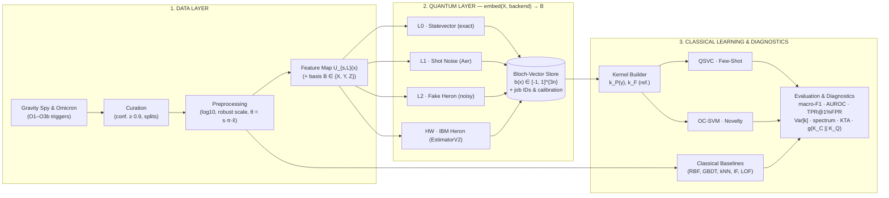

# Q-Spy - Quantum Machine Learning for Astrophysics

**Concentration-aware projected quantum kernels to classify and discover glitches in LIGO data.**

Q-Spy is an end-to-end research pipeline developed for the **Qiskit Fall Fest 2026** that uses an IBM Quantum processor (`ibm_kingston`) as a feature extractor for LIGO glitch classification, rigorously benchmarking whether quantum geometry adds value over well-tuned classical baselines.

**Authors:** Mirko Mangano, Leonardo Mirabella, Andrea Favata, Michele Bellavia, Reda Brucato.

---

## The Problem & Dataset
LIGO measures length changes smaller than a proton, recording thousands of non-Gaussian instrumental or environmental noise transients (**glitches**) that reduce detector sensitivity and can hide or mimic real gravitational-wave signals.

* **Dataset:** Curated Gravity Spy catalog (runs O1–O3b, confidence $\ge 0.9$), comprising **318,801 glitches across 8 families** (7 known families used for training, while **Fast Scattering** is held out as an unseen anomaly):
  * *Scattered Light* (112,689), *Fast Scattering* (56,509 - held out), *Tomte* (41,026), *Low Frequency Burst* (27,872), *Blip* (22,086), *Extremely Loud* (20,195), *Low Frequency Lines* (19,346), *Koi Fish* (19,078).
* **Two Core Gaps:**
  1. **Few-shot classification (RQ3):** New glitch families appear in every observing run with only a handful of labeled examples.
  2. **Novelty detection (RQ4):** Closed-set classifiers cannot flag unknown classes (e.g., *Fast Scattering* in O3 had to be discovered manually by volunteers and experts).
* **Quantum & Hardware Questions (RQ1 & RQ2):** Does the kernel remain informative without concentrating as qubit count grows, and does the signal survive real IBM QPU noise at a predictable runtime cost?

---

## The Approach
> **The quantum computer doesn't learn anything:** it changes the geometry in which glitches are compared. All parameter tuning and learning stay purely classical, no variational optimization, no barren plateaus, and predictable QPU cost upfront.

1. **Data (7 Omicron Physical Features):** Duration, peak frequency, central frequency, bandwidth, amplitude, SNR, and Q-factor, normalized to $\tilde{x} \in [-1, 1]$.
2. **Quantum Feature Map (8 Qubits, 2 Layers):** Each feature encodes rotation angles $\theta = s \cdot \pi \cdot \tilde{x}$ via $R_Y R_Z$ gates (with $q_7$ reusing SNR and bandwidth $s = 0.1778$, max rotation $0.56\text{ rad}$), entangled via two brick-wall layers of $CZ$ gates. Compiled onto `ibm_kingston` (156-qubit Heron processor, physical qubits `55-59-75-74-73-72-71-70`), this maps to **79 native gates** ($32\,\sqrt{X}$, $33\,R_Z$, $14\,CZ$) at **circuit depth 13**.
3. **Measurement (Bloch Vectors):** 3 measurement circuits per glitch ($X$, $Y$, and $Z$ bases) with **1,112 shots** each yield **24 expectation values** per glitch, requiring only **360 circuits instead of 7,140** ($N^2/2$) for the 120-glitch main hardware campaign.
4. **Projected Quantum Kernel (Huang et al. 2021):** Compares per-qubit Bloch vectors $b_q(x)$ classically via an RBF kernel:
   $$k_P(x, x') = \exp\left(-\frac{\gamma}{n} \sum_{q=1}^{n} \|b_q(x) - b_q(x')\|^2\right)$$
   This avoids full-state exponential concentration and lets $\gamma$ be tuned post-measurement without re-running on the QPU.
5. **Classical Models:** Pre-registered, nested cross-validation with identical hyperparameter budgets for quantum and classical baselines:
   * **Few-shot (`E-02`):** SVM (projected & fidelity kernels) vs. classical RBF/Laplacian SVM, $k$-NN, Gradient Boosting, and Logistic Regression ($k \in \{5, 10, 20, 50\}$ examples/family).
   * **Novelty detection (`E-03`):** One-Class SVM (projected kernel) vs. One-Class SVM (RBF), Isolation Forest, and Local Outlier Factor (LOF), rotating each of the 8 families as unseen across 10 seeds (80 runs, threshold calibrated at 5% false alarm rate on known families).

---

## System Architecture


## Repository structure
```
q-spy/
├── data/          # Gravity Spy loaders, curation, protocol splits (P1, P2, P3)
├── features/      # log10 transforms, robust scaling, bandwidth
├── quantum/       # feature_map.py, observables.py, embed.py (backend-agnostic)
├── backends/      # statevector.py, fake_heron.py, ibm_runtime.py
├── kernels/       # projected.py, fidelity.py, classical.py
├── models/        # fewshot.py, novelty.py, baselines.py, base.py
├── diagnostics/   # concentration.py, geometric_difference.py, alignment.py
├── experiments/   # YAML configs, runners, MLflow tracking
└── store/         # Bloch vectors + job IDs + calibration snapshots (parquet)
```

## Experimental Tiers & Headline Results

All hypotheses (`H1–H4`) and configurations were frozen prior to hardware execution (`git tag hw-freeze`) across four evaluation tiers: **L0** (exact statevector), **L1** (shot-noise simulation, 1,112 shots), **L2** (`ibm_kingston` noise emulator), and **HW** (`ibm_kingston` with TREX readout mitigation, Pauli twirling, and Dynamical Decoupling).

| Experiment | Key Findings & Measurements |
|---|---|
| **Concentration (`E-01`, L0)** | Projected kernel variance drops only $2\times$ from 4 to 14 qubits (vs. $6\times$ for fidelity kernel). Bandwidth $s$ dominates class alignment (KTA): **0.534** at $s=0.1778$ vs. **0.357** at $s=1$. Selected $n=8$ qubits (going to 14–16 yields only $+3\%$ KTA at $2\times$ noisy qubits). |
| **Noise Prediction (`Q-06`, L0–L2)** | Distinct glitches differ by **0.23** in Bloch space: **$8\times$ larger** than the chosen measurement noise precision (**0.030** at 1,112 shots). KTA remains virtually unchanged across L0 (**0.531**), L1 (**0.532**), and L2 (**0.530**). |
| **Hardware Pilot (`H-01`, HW)** | Measured **13 s** QPU time vs. **13.7 s** predicted by IBM cost formula; Bloch vector RMSE **0.033** vs. **0.030** shot-only (systematic bias $-0.0065$, $5\times$ below noise floor). |
| **Hardware Campaign (`H-02`, HW)** | Executed **7 jobs, 260 unseen O3b glitches, 780 circuits in 276 s** (vs. 318 s predicted):<br>• **Main (120 glitches):** Mitigated RMSE **0.030** (matching shot noise), unmitigated **0.039**; on-chip KTA **0.525** vs. **0.531** exact (`H4` passed); on-chip *Fast Scattering* AUROC **0.957** (vs. **0.954** exact and **0.951** classical RBF).<br>• **Controls:** Concentration verified on chip at 4, 8, and 12 qubits (~12% below exact due to vector shrinkage, no flattening); drift and two-run repeatability errors (**0.034** and **0.039**) stay below the **0.042** shot-noise bound. |
| **Few-Shot (`E-02` preview, L0)** | Quantum projected SVM and classical RBF SVM perform identically across all $k$ (mean difference $\pm 0.02$, within seed variance; **macro-F1 = 0.838** for both at $k=50$; `H1` not falsified). |
| **Novelty Detection (`E-03`, L0)** | Every detector reliably isolates *Fast Scattering* (**AUROC > 0.93**; no family below 0.5 across 80 runs). Classical RBF OC-SVM outperforms projected OC-SVM by **0.026** (95% CI $[-0.044, -0.008]$; **0.957** vs. **0.932** on *Fast Scattering*). |

### Honest Verdict & Future Work
On 7 summary tabular features, well-tuned classical baselines match or slightly outperform the projected quantum kernel, confirming critical QML literature under strict, pre-registered benchmarks on real astrophysics data and real quantum hardware. However, the end-to-end pipeline reliably preserves class information on IBM QPU at predictable cost.

**Where a quantum advantage could still emerge (and next steps):**
* **Richer inputs:** Time-frequency Q-transform spectrograms and auxiliary sensor channels instead of 7 summary features.
* **Non-simulable scales & higher qubits:** Scaling beyond laptop-simulable regimes and testing 14–16 qubits under hardware noise.
* **Pre-screening:** Using the geometric difference (`G-02`, Huang et al. 2021) to test whether a dataset favors quantum geometry before spending QPU time.
* **Full statistical runs:** Completing 20-seed few-shot (`E-02`) with paired Wilcoxon tests, full on-chip novelty (`E-04`), and additional kernel detectors (kernel PCA, density, $k$-NN).

---

## Repository Structure & Engineering Workflow
Built with **Qiskit 2.6, Qiskit Aer, IBM Runtime, and scikit-learn** by a 5-person team (1 lead + 4 areas: *data, quantum/hardware, machine learning, diagnostics/experiments*):
* ~70 reviewed Pull Requests, interface contracts first, and **~290 automated tests**.
* Frozen, hash-verified dataset splits; every run in `store/runs/` logs job IDs, physical qubits, daily calibration, git commit, and config for single-command reproducibility.

```text
data/features/  ──▶  quantum/  ──▶  kernels/  ──▶  models/
                        │                            │
                        ▼                            ▼
                   store/runs/               diagnostics/experiments/ ──▶ results/
```

## Documentation & Commands
Build and serve locally:
```bash
$ make install
```
Regenerate all figures:
```bash
$ make figures
```
Run the full test suite:
```bash
$ make test
```

## References
- [1] M. Zevin et al., “Gravity Spy: integrating Advanced LIGO detector characterization, machine learning, and citizen science,” Class. Quantum Grav. 34, 064003 (2017).
- [2] S. Bahaadini et al., “Machine learning for Gravity Spy: Glitch classification and dataset,” Information Sciences 444, 172 (2018).
- [3] J. Glanzer et al., “Data quality up to the third observing run of Advanced LIGO: Gravity Spy
glitch classifications,” Class. Quantum Grav. 40, 065004 (2023)
- [4] S. Soni et al., “Discovering features in gravitational-wave data through detector characterization,
citizen science and machine learning,” Class. Quantum Grav. 38(19) (2021), arXiv:2103.12104
- [5] F. Robinet et al., “Omicron: a tool to characterize transient noise in gravitational-wave detectors,”
SoftwareX 12, 100620 (2020)
- [6] D. George, H. Shen, E. A. Huerta, “Glitch classification and clustering for LIGO with deep transfer
learning,” NeurIPS 2017 Workshop on Deep Learning for Physical Sciences, arXiv:1711.07468
- [7] T. S. Fernandes et al., “Convolutional neural networks for the classification of glitches in
gravitational-wave data streams,” Class. Quantum Grav. 40, 195018 (2023), arXiv:2303.13917
- [8] Y. Wu et al., “Advancing glitch classification in Gravity Spy: multi-view fusion with attentionbased machine learning for Advanced LIGO’s fourth observing run,” arXiv:2401.12913
- [9] M. Llorens-Monteagudo, A. Torres-Forné, J. A. Font, A. Marquina, “Classification of gravitationalwave glitches via dictionary learning,” arXiv:1811.03867
- [10] M.-C. Isfan et al., “Quantum computing tools for fast detection of gravitational waves in the
context of LISA space mission,” arXiv:2509.12929
- [11] M.-C. Isfan, L.-I. Caramete, A. Caramete, “Evaluating state-of-the-art cloud quantum computers
for quantum neural networks in gravitational waves data analysis,” arXiv:2601.14036.
- [12] M. H. Hassanshahi et al., “A quantum-enhanced support vector machine for galaxy classification,”
arXiv:2306.00881
- [13] M. Ziiatdinov, F. Farsian, F. Schillirò, S. Distefano, “Comparing quantum machine learning
approaches in astrophysical signal detection,” IEEE QSW 2025, arXiv:2507.19505
- [14] T. Kawamuro et al., “Quantum machine learning for identifying transient events in X-ray light
curves,” arXiv:2507.05589
- [15] M. Kordzanganeh, A. Utting, A. Scaife, “Quantum machine learning for radio astronomy,”
NeurIPS 2021 ML4PS Workshop, arXiv:2112.02655
- [16] V. Havlíˇcek et al., “Supervised learning with quantum-enhanced feature spaces,” Nature 567, 209
(2019)
- [17] M. Schuld, N. Killoran, “Quantum machine learning in feature Hilbert spaces,” Phys. Rev. Lett.
122, 040504 (2019)
- [18] M. Schuld, “Supervised quantum machine learning models are kernel methods,”
arXiv:2101.11020
- [19] H.-Y. Huang et al., “Power of data in quantum machine learning,” Nat. Commun. 12, 2631 (2021)
- [20] Y. Liu, S. Arunachalam, K. Temme, “A rigorous and robust quantum speed-up in supervised
machine learning,” Nat. Phys. 17, 1013 (2021)
- [21] J. R. Glick et al., “Covariant quantum kernels for data with group structure,” Nat. Phys. 20, 479
(2024)
- [22] S. Thanasilp, S. Wang, M. Cerezo, Z. Holmes, “Exponential concentration in quantum kernel
methods,” Nat. Commun. (2024), doi:10.1038/s41467-024-49287-w
- [23] R. Shaydulin, S. M. Wild, “Importance of kernel bandwidth in quantum machine learning,” Phys.
Rev. A 106, 042407 (2022)
- [24] A. Canatar et al., “Bandwidth enables generalization in quantum kernel models,”
arXiv:2206.06686
- [25] Y. Suzuki, M. Li, “Effect of alternating layered ansatzes on trainability of projected quantum
kernel,” arXiv:2310.00361
- [26] J. Bowles, S. Ahmed, M. Schuld, “Better than classical? The subtle art of benchmarking quantum
machine learning models,” arXiv:2403.07059
- [27] J. Schnabel, M. Roth, “Quantum kernel methods under scrutiny: a benchmarking study,”
arXiv:2409.04406
- [28] M. Cerezo et al., “Does provable absence of barren plateaus imply classical simulability?,” Nat.
Commun. 16, 7907 (2025)
- [29] V. Belis et al., “Guided quantum compression for high dimensional data classification,” Mach.
Learn.: Sci. Technol. 5, 035010 (2024), arXiv:2402.09524
- [30] N. Liu, P. Rebentrost, “Quantum machine learning for quantum anomaly detection,” Phys. Rev. A
97, 042315 (2018)
- [31] O. Kyriienko, E. B. Magnusson, “Unsupervised quantum machine learning for fraud detection,”
arXiv:2208.01203
- [32] M. Kölle et al., “Efficient quantum one-class support vector machines for anomaly detection using
randomized measurements and variable subsampling,” arXiv:2407.20753
- [33] D. Pranji´c et al., “Unsupervised quantum anomaly detection on noisy quantum processors,”
arXiv:2411.16970
- [34] K. A. Wo´zniak et al., “Quantum anomaly detection in the latent space of proton collision events
at the LHC,” arXiv:2301.10780.
- [35] A. Pérez-Salinas et al., “Data re-uploading for a universal quantum classifier,” Quantum 4, 226
(2020)
- [36] M. E. Sahin et al., “Qiskit Machine Learning: an open-source library for quantum machine
learning tasks at scale on quantum hardware and classical simulators,” arXiv:2505.17756
- [37] A. Javadi-Abhari et al., “Quantum computing with Qiskit,” arXiv:2405.08810
- [38] E. van den Berg, Z. K. Minev, K. Temme, “Model-free readout-error mitigation for quantum
expectation values,” Phys. Rev. A 105, 032620 (2022)
- [39] J. J. Wallman, J. Emerson, “Noise tailoring for scalable quantum computation via randomized
compiling,” Phys. Rev. A 94, 052325 (2016)
- [40] K. Temme, S. Bravyi, J. M. Gambetta, “Error mitigation for short-depth quantum circuits,” Phys.
Rev. Lett. 119, 180509 (2017)
- [41] IBM Quantum Documentation, “Workload usage — estimate usage before submitting a job,”
quantum.cloud.ibm.com/docs/guides/estimate-job-run-time (accessed October 2026).

## License
GPL-3.0
