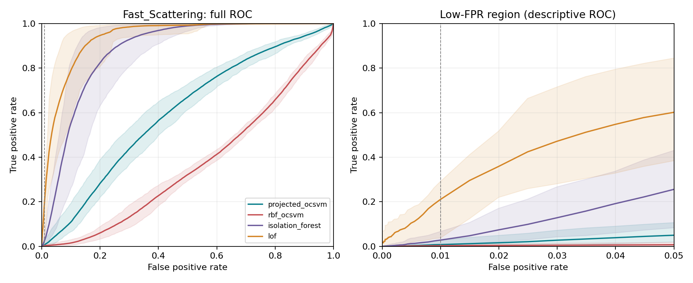

> **Risultati correnti corretti:** [E03_results_loco.md](E03_results_loco.md). Le tabelle seguenti sono lo storico precedente, conservato e non rivalidato.

# E-03 — Prior reported L0 results (not revalidated after audit)

> **Current status:** These figures are preserved from a prior run. The audit
> found that its inner-CV folds reused a scaler fitted on the full outer
> training set, so the tuning procedure was not leakage-safe. The current
> checkout also lacks the eight saved prediction archives and
> `selected_ids.json.gz` listed in its old manifest. The numerical tables and
> physics diagnostics below are historical outputs, not validated results for
> the corrected implementation. They must not be used as E-03 acceptance
> evidence. No replacement real-data results are claimed in this report.

## Ambito della misura

Eseguiti **80 casi P2**, con 8 famiglie held-out, 10 seed e quattro modelli. Input: 318,801 righe, verificate rispetto al bundle D-04 scelto. Questa esecuzione usa sottoinsiemi stratificati: al massimo **2048 train / 2048 validation / 8192 test** per caso, comuni ai quattro modelli. I risultati NON rappresentano un fit sull'intero training P2.

Embedding esatto L0: 8 qubit, 2 layer, s=0.1778, CZ attivi. Budget uguale: 8 configurazioni per modello, 3 fold interni. Training, tuning e scaling escludono le famiglie sconosciute; la soglia operativa usa soltanto validation di classi note. Nessuna esecuzione hardware.

Durata registrata: 5.66 minuti. Versioni: matplotlib 3.10.9, numpy 2.2.6, pandas 2.3.3, qiskit 2.6.2, qiskit-aer 0.17.2, scikit-learn 1.7.2.

## Fast_Scattering: confronto principale

Media sui dieci seed e CI bootstrap 95% tra parentesi, condizionati al test fissato. TPR@1%FPR è una statistica descrittiva della ROC del test, senza interpolare punti non raggiunti. Le ultime due colonne usano invece la soglia scelta sulla validation nota, senza usare il test per sceglierla.

| Modello | AUROC [CI] | AP [CI] | TPR@1%FPR [CI] | TPR soglia validation [CI] | FPR test soglia validation [CI] |
| --- | --- | --- | --- | --- | --- |
| projected_ocsvm | 0.6007 [0.5837, 0.6189] | 0.5747 [0.5558, 0.5961] | 0.0080 [0.0027, 0.0144] | 0.0113 [0.0044, 0.0195] | 0.0144 [0.0129, 0.0162] |
| rbf_ocsvm | 0.3643 [0.3534, 0.3753] | 0.4208 [0.4138, 0.4277] | 0.0029 [0.0016, 0.0046] | 0.0028 [0.0016, 0.0044] | 0.0100 [0.0086, 0.0114] |
| isolation_forest | 0.8778 [0.8507, 0.9037] | 0.8162 [0.7827, 0.8480] | 0.0281 [0.0156, 0.0418] | 0.0292 [0.0200, 0.0381] | 0.0108 [0.0091, 0.0124] |
| lof | 0.9377 [0.9218, 0.9529] | 0.9181 [0.9022, 0.9345] | 0.2107 [0.1514, 0.2565] | 0.1996 [0.1390, 0.2500] | 0.0092 [0.0085, 0.0101] |

Test principale per seed: 8192 eventi, frazione positiva 0.5179. AP dipende da questa prevalenza.

La fascia grafica è il percentile empirico 2,5–97,5% delle curve dei seed. Non è una banda di confidenza su eventi indipendenti. La curva è interpolata solo per visualizzazione.

## Rotazione della famiglia held-out

Ogni riga confronta soltanto la famiglia indicata con le famiglie note di quel fold (`target_family`), omettendo dal calcolo l'altra famiglia sconosciuta. Fast_Scattering resta comunque fuori da ogni training/validation. I risultati con entrambe le famiglie sconosciute positive sono disponibili separatamente come `protocol_unknown` nei CSV.

| Famiglia held-out | Modello | AUROC [CI] | AP [CI] | TPR@1%FPR [CI] |
| --- | --- | --- | --- | --- |
| Fast_Scattering | projected_ocsvm | 0.6007 [0.5837, 0.6189] | 0.5747 [0.5558, 0.5961] | 0.0080 [0.0027, 0.0144] |
| Fast_Scattering | rbf_ocsvm | 0.3643 [0.3534, 0.3753] | 0.4208 [0.4138, 0.4277] | 0.0029 [0.0016, 0.0046] |
| Fast_Scattering | isolation_forest | 0.8778 [0.8507, 0.9037] | 0.8162 [0.7827, 0.8480] | 0.0281 [0.0156, 0.0418] |
| Fast_Scattering | lof | 0.9377 [0.9218, 0.9529] | 0.9181 [0.9022, 0.9345] | 0.2107 [0.1514, 0.2565] |
| Blip | projected_ocsvm | 0.4820 [0.4297, 0.5386] | 0.2836 [0.2587, 0.3146] | 0.0004 [0.0000, 0.0008] |
| Blip | rbf_ocsvm | 0.8769 [0.8441, 0.9022] | 0.7424 [0.6873, 0.7884] | 0.2141 [0.1520, 0.2695] |
| Blip | isolation_forest | 0.9628 [0.9546, 0.9703] | 0.8870 [0.8546, 0.9165] | 0.3070 [0.2019, 0.4184] |
| Blip | lof | 0.8229 [0.7828, 0.8623] | 0.6432 [0.5877, 0.6983] | 0.0581 [0.0343, 0.0827] |
| Extremely_Loud | projected_ocsvm | 0.1918 [0.1721, 0.2136] | 0.1851 [0.1808, 0.1900] | 0.0011 [0.0005, 0.0017] |
| Extremely_Loud | rbf_ocsvm | 0.8922 [0.8846, 0.9005] | 0.7878 [0.7646, 0.8100] | 0.3399 [0.2801, 0.3976] |
| Extremely_Loud | isolation_forest | 0.8274 [0.7940, 0.8565] | 0.5468 [0.5000, 0.5914] | 0.0114 [0.0101, 0.0127] |
| Extremely_Loud | lof | 0.8029 [0.7632, 0.8405] | 0.5729 [0.5356, 0.6110] | 0.0375 [0.0213, 0.0559] |
| Koi_Fish | projected_ocsvm | 0.6570 [0.6220, 0.6877] | 0.3693 [0.3384, 0.3978] | 0.0076 [0.0045, 0.0113] |
| Koi_Fish | rbf_ocsvm | 0.5054 [0.4799, 0.5366] | 0.2591 [0.2465, 0.2778] | 0.0008 [0.0000, 0.0021] |
| Koi_Fish | isolation_forest | 0.8403 [0.8164, 0.8612] | 0.5876 [0.5542, 0.6183] | 0.0390 [0.0318, 0.0474] |
| Koi_Fish | lof | 0.8284 [0.8110, 0.8433] | 0.5362 [0.5031, 0.5653] | 0.0079 [0.0037, 0.0125] |
| Low_Frequency_Burst | projected_ocsvm | 0.4489 [0.4100, 0.4870] | 0.3399 [0.3172, 0.3628] | 0.0045 [0.0029, 0.0068] |
| Low_Frequency_Burst | rbf_ocsvm | 0.8538 [0.8397, 0.8666] | 0.7759 [0.7636, 0.7912] | 0.2361 [0.2133, 0.2582] |
| Low_Frequency_Burst | isolation_forest | 0.9255 [0.9099, 0.9381] | 0.8532 [0.8218, 0.8787] | 0.2516 [0.1914, 0.3099] |
| Low_Frequency_Burst | lof | 0.7511 [0.6869, 0.8049] | 0.6174 [0.5464, 0.6833] | 0.0557 [0.0080, 0.1073] |
| Low_Frequency_Lines | projected_ocsvm | 0.7120 [0.6955, 0.7266] | 0.4729 [0.4509, 0.4949] | 0.0591 [0.0446, 0.0751] |
| Low_Frequency_Lines | rbf_ocsvm | 0.7763 [0.7685, 0.7837] | 0.5271 [0.5092, 0.5457] | 0.0603 [0.0479, 0.0731] |
| Low_Frequency_Lines | isolation_forest | 0.8351 [0.8123, 0.8557] | 0.5910 [0.5542, 0.6304] | 0.0454 [0.0354, 0.0586] |
| Low_Frequency_Lines | lof | 0.6509 [0.6345, 0.6684] | 0.3759 [0.3606, 0.3934] | 0.0130 [0.0059, 0.0204] |
| Scattered_Light | projected_ocsvm | 0.6243 [0.5947, 0.6561] | 0.8683 [0.8554, 0.8819] | 0.0971 [0.0721, 0.1245] |
| Scattered_Light | rbf_ocsvm | 0.3300 [0.3089, 0.3530] | 0.6811 [0.6714, 0.6916] | 0.0000 [0.0000, 0.0000] |
| Scattered_Light | isolation_forest | 0.8167 [0.7796, 0.8508] | 0.9147 [0.8946, 0.9329] | 0.0325 [0.0214, 0.0438] |
| Scattered_Light | lof | 0.8658 [0.8456, 0.8843] | 0.9383 [0.9303, 0.9454] | 0.0442 [0.0262, 0.0638] |
| Tomte | projected_ocsvm | 0.3811 [0.3557, 0.4109] | 0.3903 [0.3791, 0.4034] | 0.0071 [0.0055, 0.0088] |
| Tomte | rbf_ocsvm | 0.5891 [0.5822, 0.5953] | 0.4925 [0.4873, 0.4969] | 0.0016 [0.0011, 0.0022] |
| Tomte | isolation_forest | 0.9166 [0.8930, 0.9361] | 0.8371 [0.7990, 0.8678] | 0.0231 [0.0115, 0.0377] |
| Tomte | lof | 0.9040 [0.8899, 0.9183] | 0.8873 [0.8707, 0.9046] | 0.2730 [0.1957, 0.3526] |

## Differenze appaiate nel replay principale

Differenza projected meno baseline sullo stesso seed. I CI ricampionano gli stessi indici di seed per i quattro modelli. Sono descrittivi della variabilità di training/tuning su questo test; non dimostrano superiorità statistica generale o vantaggio quantistico.

| Confronto | Metrica | Differenza media [CI 95%] |
| --- | --- | --- |
| projected_ocsvm minus rbf_ocsvm | ap | 0.1539 [0.1324, 0.1771] |
| projected_ocsvm minus isolation_forest | ap | -0.2415 [-0.2829, -0.1953] |
| projected_ocsvm minus lof | ap | -0.3434 [-0.3682, -0.3195] |
| projected_ocsvm minus rbf_ocsvm | auroc | 0.2364 [0.2133, 0.2575] |
| projected_ocsvm minus isolation_forest | auroc | -0.2771 [-0.3126, -0.2399] |
| projected_ocsvm minus lof | auroc | -0.3370 [-0.3609, -0.3126] |
| projected_ocsvm minus rbf_ocsvm | tpr_at_1pct_fpr | 0.0050 [-0.0004, 0.0118] |
| projected_ocsvm minus isolation_forest | tpr_at_1pct_fpr | -0.0201 [-0.0342, -0.0068] |
| projected_ocsvm minus lof | tpr_at_1pct_fpr | -0.2027 [-0.2459, -0.1458] |

## Nota fisica e analisi degli errori

Un OC-SVM/Isolation Forest/LOF decide noto contro anomalo: non predice quale famiglia nota sia Fast_Scattering. Perciò separiamo le famiglie note erroneamente segnalate come anomale dai vicini noti degli eventi Fast_Scattering mancati.

### Famiglie note più spesso segnalate come anomalie

Falso positivo alla soglia calibrata su validation, nel fold Fast_Scattering. Le tre famiglie con tasso più alto per modello sono mostrate sotto. Le decisioni sono sommate sui seed, che riusano gli stessi eventi: questi denominatori NON sono numeri di eventi fisici indipendenti.

| Modello | Famiglia nota | Decisioni anomale / decisioni totali | Tasso |
| --- | --- | --- | --- |
| projected_ocsvm | Low_Frequency_Lines | 94 / 2920 | 0.0322 |
| projected_ocsvm | Low_Frequency_Burst | 127 / 4200 | 0.0302 |
| projected_ocsvm | Tomte | 171 / 6170 | 0.0277 |
| rbf_ocsvm | Low_Frequency_Burst | 187 / 4200 | 0.0445 |
| rbf_ocsvm | Blip | 105 / 3330 | 0.0315 |
| rbf_ocsvm | Low_Frequency_Lines | 55 / 2920 | 0.0188 |
| isolation_forest | Low_Frequency_Lines | 103 / 2920 | 0.0353 |
| isolation_forest | Low_Frequency_Burst | 129 / 4200 | 0.0307 |
| isolation_forest | Koi_Fish | 29 / 2880 | 0.0101 |
| lof | Extremely_Loud | 116 / 3050 | 0.0380 |
| lof | Low_Frequency_Lines | 58 / 2920 | 0.0199 |
| lof | Blip | 25 / 3330 | 0.0075 |

### Famiglie vicine ai Fast_Scattering non rilevati

Per ogni Fast_Scattering sotto la soglia, cerchiamo il vicino più prossimo nel training noto, nello spazio classico delle sette feature trasformate (distanza euclidea, non nello spazio quantistico). Le due famiglie più frequenti per modello sono un indizio di sovrapposizione delle feature, non una matrice di classificazione. La frequenza dei vicini dipende anche dalla numerosità e densità delle famiglie nel training sbilanciato; da sola non prova una maggiore confusione morfologica.

| Modello | Famiglia del vicino noto | Fast_Scattering mancati associati | Quota dei mancati |
| --- | --- | --- | --- |
| projected_ocsvm | Tomte | 23224 | 0.5536 |
| projected_ocsvm | Scattered_Light | 15872 | 0.3784 |
| rbf_ocsvm | Tomte | 23437 | 0.5539 |
| rbf_ocsvm | Scattered_Light | 15972 | 0.3775 |
| isolation_forest | Tomte | 22880 | 0.5554 |
| isolation_forest | Scattered_Light | 15582 | 0.3783 |
| lof | Tomte | 19000 | 0.5595 |
| lof | Scattered_Light | 12635 | 0.3721 |

In questa esecuzione, aggregando le decisioni dei seed e dei quattro modelli, le famiglie dei vicini più frequenti sono **Tomte e Scattered_Light**. È il risultato misurato della diagnostica di vicinato, non un'etichetta predetta dai detector.

Per Tomte una spiegazione plausibile è la sovrapposizione di descrittori a bassa frequenza: Glanzer et al. descrivono eventi Tomte spesso attorno a 40 Hz e Fast Scattering O3 quasi sempre sotto circa 60 Hz [1]. Questo non stabilisce una causa comune: lo stesso articolo segnala che l'accoppiamento fisico dei Tomte non è identificato. Lo scarto di informazione morfologica passando dalle immagini a sette numeri è una possibile spiegazione della vicinanza, non una verifica sperimentale del meccanismo.

**Interpretazione, distinta dal dato misurato.** Fast_Scattering e Scattered_Light sono popolazioni legate allo scattering; la letteratura collega Fast Scatter a moto di superfici ottiche e disturbi sismici a frequenze superiori a 1 Hz [1,2]. Una vicinanza a Scattered_Light è quindi fisicamente plausibile, ma deve essere verificata nei numeri sopra e non assunta come risultato. Vicini di altre famiglie indicano somiglianza dei descrittori scalari, non l'identificazione dello stesso accoppiamento fisico.

Le sette feature riassumono durata, frequenze, banda, ampiezza, SNR e Q; non contengono gli archi tempo-frequenza delle immagini usate dalle classificazioni Gravity Spy. La trasformazione log/RobustScaler/clipping può inoltre rendere uguali gli estremi di popolazioni diverse. L'embedding R3 è una trasformazione di queste stesse feature: non aggiunge dati sui canali ambientali o sulla morfologia delle immagini. Sono spiegazioni possibili dei fallimenti, non una misura causale eseguita qui.

Nel dataset curato Fast_Scattering è quasi tutto L1 (55.229 su 56.509) e soltanto O3; le famiglie note mescolano detector e run. La letteratura riporta differenze fra siti e una maggiore prevalenza di Fast Scattering a Livingston [1]. Pur senza usare ifo/run come input, le feature possono riflettere questi domini. La selezione stratificata preserva, non elimina, questo confondimento. P2 non equivale a una prova di generalizzazione temporale O3a→O3b o di trasferimento tra detector.

## Lettura del confronto

In questa configurazione il miglior AUROC medio è di **lof**. Il confronto con le baseline complete è essenziale: un miglioramento sul solo OC-SVM RBF non dimostra un vantaggio sui migliori metodi classici né un vantaggio computazionale.

L'AUROC dell'OC-SVM RBF è sotto 0,5. Il segno dello score resta quello del contratto condiviso (più alto = più anomalo): non viene invertito a posteriori usando le etichette held-out. Questo risultato segnala un fallimento di ranking nel replay, non viene corretto ottimizzando sul test.

## Controlli e limiti

Suite completa: **249 test e 190 subtest passati**; suite E-03 aggiornata: **14 test passati**. Nessun test fallito.

Verifica indipendente dai file delle predizioni: **80 casi**, **3200 valori metrici** ricalcolati. Controllati hash degli output, appartenenza ai partition ID originali, esclusione delle famiglie sconosciute da TUTTO il train/validation P2, etichette del catalogo, test fisso fra seed, budget uguali e CI/differenze appaiate ricalcolate.

La configurazione è resource-bounded e non include un'analisi di sensibilità ai cap o ai parametri del circuito. Gli intervalli sono condizionati al test e non includono l'incertezza della scelta del circuito, del dataset o delle etichette ML. Le rotazioni condividono dati e non sono otto dataset indipendenti. Le etichette sono quelle ML d

## Current review receipt — 2026-11-25

No numerical result above has been revalidated. All nine present manifest-listed
outputs retain their historical hashes, but eight prediction archives and the
selected-ID archive are absent. The old source fingerprints also differ from
the supplied working tree. The corrected pipeline has no replacement real-data
run: the dataset and pinned scientific environment are unavailable.

The 18 passing integrity tests and the read-only 80-case D-04 membership check
are narrower checks, not validation of these metrics, confidence intervals or
physics diagnostics. See [E03_REVIEW_REPORT.md](E03_REVIEW_REPORT.md) and the
current [E03_validation.json](E03_validation.json). Final status:
**IMPLEMENTED — NOT VALIDATED**.
