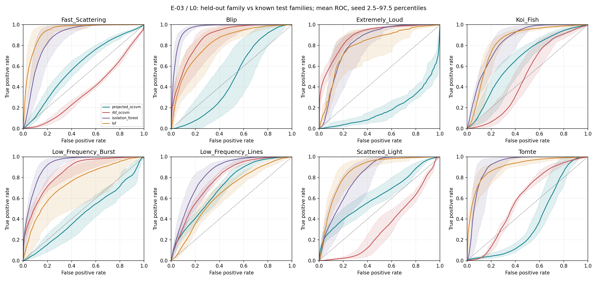

# E-03 — Risultati L0: Gravity Spy D-02 (issue #29)

## Ambito della misura

Eseguiti **80 casi P2**, con 8 famiglie held-out, 10 seed e quattro modelli. Input: 318,801 righe, verificate rispetto al bundle D-04 scelto. Questa esecuzione usa sottoinsiemi stratificati: al massimo **2048 train / 2048 validation / 8192 test** per caso, comuni ai quattro modelli. I risultati NON rappresentano un fit sull'intero training P2.

Embedding esatto L0: 8 qubit, 2 layer, s=0.1778, CZ attivi. Budget massimo: 60 configurazioni per modello, rotazioni interne leave-one-classe-nota-out, con scaler rifatto in ciascuna rotazione. Training, tuning e scaling escludono le famiglie sconosciute; la soglia operativa usa soltanto validation di classi note. Nessuna esecuzione hardware.

Durata registrata: 16.66 minuti. Versioni: matplotlib 3.10.9, numpy 2.2.6, pandas 2.3.3, qiskit 2.6.2, qiskit-aer 0.17.2, scikit-learn 1.7.2.

## Revisione metodologica

Questa esecuzione sostituisce i risultati precedenti basati sulla sola calibrazione FPR. Gamma massimizza ora AUROC sulle classi note usate a turno come anomalie surrogate; nu minimizza lo scarto dal 5% di falsi allarmi sui soli noti. Configurazioni effettive: isolation_forest: 60; lof: 15; projected_ocsvm: 54; rbf_ocsvm: 54. La griglia completa OC-SVM (nove c e sei nu) richiede budget≥54; i run con budget minore sono esplorativi. Il limite e la deviazione dal conteggio esatto sono documentati in E03_review.md. La soglia al 5% del modello è distinta dalla soglia al 1% usata per le diagnostiche qui riportate. H3 resta una ipotesi primaria; questi CI non sostituiscono il test con correzione Holm H1–H4.

## Fast_Scattering: confronto principale

Media sui dieci seed e CI bootstrap 95% tra parentesi, condizionati al test fissato. TPR@1%FPR è una statistica descrittiva della ROC del test, senza interpolare punti non raggiunti. Le ultime due colonne usano invece la soglia scelta sulla validation nota, senza usare il test per sceglierla.

| Modello | AUROC [CI] | AP [CI] | TPR@1%FPR [CI] | TPR soglia validation [CI] | FPR test soglia validation [CI] |
| --- | --- | --- | --- | --- | --- |
| projected_ocsvm | 0.9316 [0.9133, 0.9489] | 0.9003 [0.8832, 0.9162] | 0.0859 [0.0691, 0.1022] | 0.1175 [0.0849, 0.1487] | 0.0121 [0.0102, 0.0142] |
| rbf_ocsvm | 0.9574 [0.9549, 0.9603] | 0.9251 [0.9208, 0.9294] | 0.0955 [0.0750, 0.1198] | 0.1254 [0.1018, 0.1506] | 0.0117 [0.0108, 0.0129] |
| isolation_forest | 0.9413 [0.9371, 0.9451] | 0.8894 [0.8827, 0.8960] | 0.0371 [0.0302, 0.0450] | 0.0463 [0.0387, 0.0535] | 0.0117 [0.0105, 0.0130] |
| lof | 0.9470 [0.9300, 0.9598] | 0.9309 [0.9165, 0.9438] | 0.2167 [0.1665, 0.2748] | 0.2179 [0.1604, 0.2801] | 0.0094 [0.0082, 0.0106] |

## Audit della selezione OC-SVM

Il margine fra primo e secondo gamma è ora misurato in AUROC sulle anomalie surrogate, non in aderenza della FPR a nu. Un margine piccolo segnala comunque una selezione poco identificata; non viene nascosto né usato per invertire gli score sul test.

| Modello | Casi | Margine AUROC mediano | Casi con margine <0,01 | c scelti (conteggi) | FPR nativa validation min–max |
| --- | --- | --- | --- | --- | --- |
| projected_ocsvm | 80 | 0.00715 | 54 | 10: 32, 31.62: 43, 100: 5 | 0.1665–0.6714 |
| rbf_ocsvm | 80 | 0.00800 | 53 | 10: 4, 31.62: 67, 100: 9 | 0.1040–0.6582 |

La soglia calibrata al 5% mantiene FPR empirica sui noti ≤5%; la FPR nativa dell'OC-SVM non raggiunge il target nella griglia provata. Si tratta di una deviazione materiale: il 5% è ottenuto calibrando separatamente l'intercetta/soglia sui noti, non tramite nu da solo. Il controllo esteso di nu e tolleranza su un caso noto è in E03_nu_check.json; motivazione e limiti sono in E03_review.md. Tutti i punteggi di selezione e residui di calibrazione sono conservati nell'audit.

Test principale per seed: 8192 eventi, frazione positiva 0.5179. AP dipende da questa prevalenza.

La fascia grafica è il percentile empirico 2,5–97,5% delle curve dei seed. Non è una banda di confidenza su eventi indipendenti. La curva è interpolata solo per visualizzazione.

## Rotazione della famiglia held-out

Ogni riga confronta soltanto la famiglia indicata con le famiglie note di quel fold (`target_family`), omettendo dal calcolo l'altra famiglia sconosciuta. Fast_Scattering resta comunque fuori da ogni training/validation. I risultati con entrambe le famiglie sconosciute positive sono disponibili separatamente come `protocol_unknown` nei CSV.

| Famiglia held-out | Modello | AUROC [CI] | AP [CI] | TPR@1%FPR [CI] |
| --- | --- | --- | --- | --- |
| Fast_Scattering | projected_ocsvm | 0.9316 [0.9133, 0.9489] | 0.9003 [0.8832, 0.9162] | 0.0859 [0.0691, 0.1022] |
| Fast_Scattering | rbf_ocsvm | 0.9574 [0.9549, 0.9603] | 0.9251 [0.9208, 0.9294] | 0.0955 [0.0750, 0.1198] |
| Fast_Scattering | isolation_forest | 0.9413 [0.9371, 0.9451] | 0.8894 [0.8827, 0.8960] | 0.0371 [0.0302, 0.0450] |
| Fast_Scattering | lof | 0.9470 [0.9300, 0.9598] | 0.9309 [0.9165, 0.9438] | 0.2167 [0.1665, 0.2748] |
| Blip | projected_ocsvm | 0.8893 [0.8757, 0.9028] | 0.7192 [0.6866, 0.7530] | 0.0441 [0.0274, 0.0655] |
| Blip | rbf_ocsvm | 0.8976 [0.8829, 0.9107] | 0.7335 [0.6943, 0.7710] | 0.0800 [0.0482, 0.1138] |
| Blip | isolation_forest | 0.9630 [0.9595, 0.9669] | 0.8744 [0.8624, 0.8885] | 0.2280 [0.1764, 0.2943] |
| Blip | lof | 0.9016 [0.8859, 0.9165] | 0.7639 [0.7307, 0.7951] | 0.1331 [0.0833, 0.1817] |
| Extremely_Loud | projected_ocsvm | 0.8081 [0.7898, 0.8249] | 0.6072 [0.5726, 0.6397] | 0.0310 [0.0204, 0.0429] |
| Extremely_Loud | rbf_ocsvm | 0.8159 [0.8006, 0.8308] | 0.6228 [0.5923, 0.6518] | 0.0482 [0.0381, 0.0582] |
| Extremely_Loud | isolation_forest | 0.8740 [0.8611, 0.8873] | 0.6385 [0.6069, 0.6713] | 0.0144 [0.0120, 0.0170] |
| Extremely_Loud | lof | 0.8346 [0.8140, 0.8540] | 0.5991 [0.5667, 0.6306] | 0.0337 [0.0177, 0.0516] |
| Koi_Fish | projected_ocsvm | 0.8032 [0.7769, 0.8274] | 0.5577 [0.5133, 0.6017] | 0.0169 [0.0149, 0.0188] |
| Koi_Fish | rbf_ocsvm | 0.8564 [0.8414, 0.8697] | 0.6575 [0.6206, 0.6912] | 0.0500 [0.0337, 0.0696] |
| Koi_Fish | isolation_forest | 0.8468 [0.8358, 0.8573] | 0.5950 [0.5778, 0.6121] | 0.0366 [0.0301, 0.0427] |
| Koi_Fish | lof | 0.8196 [0.8056, 0.8346] | 0.5201 [0.4921, 0.5506] | 0.0107 [0.0062, 0.0161] |
| Low_Frequency_Burst | projected_ocsvm | 0.7885 [0.7670, 0.8096] | 0.7136 [0.6926, 0.7347] | 0.1949 [0.1609, 0.2219] |
| Low_Frequency_Burst | rbf_ocsvm | 0.8030 [0.7759, 0.8271] | 0.7367 [0.7133, 0.7592] | 0.2181 [0.1829, 0.2497] |
| Low_Frequency_Burst | isolation_forest | 0.9348 [0.9315, 0.9385] | 0.8767 [0.8687, 0.8848] | 0.3212 [0.2932, 0.3449] |
| Low_Frequency_Burst | lof | 0.8007 [0.7812, 0.8185] | 0.6427 [0.6211, 0.6639] | 0.0218 [0.0100, 0.0368] |
| Low_Frequency_Lines | projected_ocsvm | 0.7874 [0.7717, 0.8006] | 0.5425 [0.5204, 0.5637] | 0.0319 [0.0266, 0.0381] |
| Low_Frequency_Lines | rbf_ocsvm | 0.8089 [0.7949, 0.8214] | 0.6020 [0.5790, 0.6214] | 0.0457 [0.0380, 0.0553] |
| Low_Frequency_Lines | isolation_forest | 0.8562 [0.8477, 0.8646] | 0.6162 [0.5996, 0.6325] | 0.0426 [0.0382, 0.0465] |
| Low_Frequency_Lines | lof | 0.6296 [0.6091, 0.6484] | 0.3599 [0.3441, 0.3752] | 0.0168 [0.0113, 0.0222] |
| Scattered_Light | projected_ocsvm | 0.8601 [0.8349, 0.8781] | 0.9469 [0.9405, 0.9521] | 0.0887 [0.0785, 0.0984] |
| Scattered_Light | rbf_ocsvm | 0.8836 [0.8578, 0.9048] | 0.9553 [0.9480, 0.9615] | 0.1106 [0.0941, 0.1269] |
| Scattered_Light | isolation_forest | 0.8873 [0.8744, 0.9014] | 0.9470 [0.9412, 0.9535] | 0.0562 [0.0442, 0.0743] |
| Scattered_Light | lof | 0.8749 [0.8607, 0.8908] | 0.9365 [0.9308, 0.9432] | 0.0143 [0.0095, 0.0195] |
| Tomte | projected_ocsvm | 0.9229 [0.9029, 0.9392] | 0.8962 [0.8735, 0.9150] | 0.2001 [0.1387, 0.2723] |
| Tomte | rbf_ocsvm | 0.9152 [0.8991, 0.9311] | 0.8888 [0.8714, 0.9058] | 0.1437 [0.1133, 0.1751] |
| Tomte | isolation_forest | 0.9426 [0.9375, 0.9485] | 0.8766 [0.8674, 0.8891] | 0.0305 [0.0152, 0.0503] |
| Tomte | lof | 0.8910 [0.8769, 0.9067] | 0.8735 [0.8573, 0.8908] | 0.2820 [0.2055, 0.3587] |

## Differenze appaiate nel replay principale

Differenza projected meno baseline sullo stesso seed. I CI ricampionano gli stessi indici di seed per i quattro modelli. Sono descrittivi della variabilità di training/tuning su questo test; non dimostrano superiorità statistica generale o vantaggio quantistico.

| Confronto | Metrica | Differenza media [CI 95%] |
| --- | --- | --- |
| projected_ocsvm minus rbf_ocsvm | ap | -0.0248 [-0.0410, -0.0093] |
| projected_ocsvm minus isolation_forest | ap | 0.0109 [-0.0059, 0.0273] |
| projected_ocsvm minus lof | ap | -0.0306 [-0.0529, -0.0126] |
| projected_ocsvm minus rbf_ocsvm | auroc | -0.0258 [-0.0441, -0.0077] |
| projected_ocsvm minus isolation_forest | auroc | -0.0097 [-0.0275, 0.0069] |
| projected_ocsvm minus lof | auroc | -0.0155 [-0.0388, 0.0037] |
| projected_ocsvm minus rbf_ocsvm | tpr_at_1pct_fpr | -0.0096 [-0.0271, 0.0059] |
| projected_ocsvm minus isolation_forest | tpr_at_1pct_fpr | 0.0489 [0.0320, 0.0638] |
| projected_ocsvm minus lof | tpr_at_1pct_fpr | -0.1308 [-0.1935, -0.0782] |

## Nota fisica e analisi degli errori

Un OC-SVM/Isolation Forest/LOF decide noto contro anomalo: non predice quale famiglia nota sia Fast_Scattering. Perciò separiamo le famiglie note erroneamente segnalate come anomale dai vicini noti degli eventi Fast_Scattering mancati.

### Famiglie note più spesso segnalate come anomalie

Falso positivo alla soglia calibrata su validation, nel fold Fast_Scattering. Le tre famiglie con tasso più alto per modello sono mostrate sotto. Le decisioni sono sommate sui seed, che riusano gli stessi eventi: questi denominatori NON sono numeri di eventi fisici indipendenti.

| Modello | Famiglia nota | Decisioni anomale / decisioni totali | Tasso |
| --- | --- | --- | --- |
| projected_ocsvm | Low_Frequency_Lines | 52 / 2920 | 0.0178 |
| projected_ocsvm | Extremely_Loud | 44 / 3050 | 0.0144 |
| projected_ocsvm | Scattered_Light | 221 / 16940 | 0.0130 |
| rbf_ocsvm | Low_Frequency_Lines | 55 / 2920 | 0.0188 |
| rbf_ocsvm | Extremely_Loud | 51 / 3050 | 0.0167 |
| rbf_ocsvm | Tomte | 68 / 6170 | 0.0110 |
| isolation_forest | Low_Frequency_Lines | 129 / 2920 | 0.0442 |
| isolation_forest | Low_Frequency_Burst | 144 / 4200 | 0.0343 |
| isolation_forest | Extremely_Loud | 32 / 3050 | 0.0105 |
| lof | Low_Frequency_Lines | 74 / 2920 | 0.0253 |
| lof | Extremely_Loud | 66 / 3050 | 0.0216 |
| lof | Tomte | 52 / 6170 | 0.0084 |

### Famiglie vicine ai Fast_Scattering non rilevati

Per ogni Fast_Scattering sotto la soglia, cerchiamo il vicino più prossimo nel training noto, nello spazio classico delle sette feature trasformate (distanza euclidea, non nello spazio quantistico). Le due famiglie più frequenti per modello sono un indizio di sovrapposizione delle feature, non una matrice di classificazione. La frequenza dei vicini dipende anche dalla numerosità e densità delle famiglie nel training sbilanciato; da sola non prova una maggiore confusione morfologica.

| Modello | Famiglia del vicino noto | Fast_Scattering mancati associati | Quota dei mancati |
| --- | --- | --- | --- |
| projected_ocsvm | Tomte | 21907 | 0.5850 |
| projected_ocsvm | Scattered_Light | 13084 | 0.3494 |
| rbf_ocsvm | Tomte | 21551 | 0.5807 |
| rbf_ocsvm | Scattered_Light | 13102 | 0.3531 |
| isolation_forest | Tomte | 22569 | 0.5577 |
| isolation_forest | Scattered_Light | 15312 | 0.3784 |
| lof | Tomte | 19643 | 0.5920 |
| lof | Scattered_Light | 11417 | 0.3441 |

In questa esecuzione, aggregando le decisioni dei seed e dei quattro modelli, le famiglie dei vicini più frequenti sono **Tomte e Scattered_Light**. È il risultato misurato della diagnostica di vicinato, non un'etichetta predetta dai detector.

Per Tomte una spiegazione plausibile è la sovrapposizione di descrittori a bassa frequenza: Glanzer et al. descrivono eventi Tomte spesso attorno a 40 Hz e Fast Scattering O3 quasi sempre sotto circa 60 Hz [1]. Questo non stabilisce una causa comune: lo stesso articolo segnala che l'accoppiamento fisico dei Tomte non è identificato. Lo scarto di informazione morfologica passando dalle immagini a sette numeri è una possibile spiegazione della vicinanza, non una verifica sperimentale del meccanismo.

**Interpretazione, distinta dal dato misurato.** Fast_Scattering e Scattered_Light sono popolazioni legate allo scattering; la letteratura collega Fast Scatter a moto di superfici ottiche e disturbi sismici a frequenze superiori a 1 Hz [1,2]. Una vicinanza a Scattered_Light è quindi fisicamente plausibile, ma deve essere verificata nei numeri sopra e non assunta come risultato. Vicini di altre famiglie indicano somiglianza dei descrittori scalari, non l'identificazione dello stesso accoppiamento fisico.

Le sette feature riassumono durata, frequenze, banda, ampiezza, SNR e Q; non contengono gli archi tempo-frequenza delle immagini usate dalle classificazioni Gravity Spy. La trasformazione log/RobustScaler/clipping può inoltre rendere uguali gli estremi di popolazioni diverse. L'embedding R3 è una trasformazione di queste stesse feature: non aggiunge dati sui canali ambientali o sulla morfologia delle immagini. Sono spiegazioni possibili dei fallimenti, non una misura causale eseguita qui.

Nel dataset curato Fast_Scattering è quasi tutto L1 (55.229 su 56.509) e soltanto O3; le famiglie note mescolano detector e run. La letteratura riporta differenze fra siti e una maggiore prevalenza di Fast Scattering a Livingston [1]. Pur senza usare ifo/run come input, le feature possono riflettere questi domini. La selezione stratificata preserva, non elimina, questo confondimento. P2 non equivale a una prova di generalizzazione temporale O3a→O3b o di trasferimento tra detector.

## Lettura del confronto

In questa configurazione il miglior AUROC medio è di **rbf_ocsvm**. Il confronto con le baseline complete è essenziale: un miglioramento sul solo OC-SVM RBF non dimostra un vantaggio sui migliori metodi classici né un vantaggio computazionale.

## Controlli e limiti

Verifica indipendente dai file delle predizioni: **80 casi**, **3200 valori metrici** ricalcolati. Controllati hash degli output, appartenenza ai partition ID originali, esclusione delle famiglie sconosciute da TUTTO il train/validation P2, etichette del catalogo, test fisso fra seed, limiti di budget e CI/differenze appaiate ricalcolate.

La configurazione è resource-bounded e non include un'analisi di sensibilità ai cap o ai parametri del circuito. Gli intervalli sono condizionati al test e non includono l'incertezza della scelta del circuito, del dataset o delle etichette ML. Le rotazioni condividono dati e non sono otto dataset indipendenti. Le etichette sono quelle ML della release, non verità fisica verificata caso per caso.

Metodo, comandi di riproduzione e significato di ogni output: [E03.md](E03.md). Suite di test e provenienza dello ZIP di base: [E03_validation.json](E03_validation.json).

## Riferimenti primari

1. Glanzer et al. (2023), *Data quality up to the third observing run of advanced LIGO: Gravity Spy glitch classifications*, [DOI 10.1088/1361-6382/acb633](https://doi.org/10.1088/1361-6382/acb633).

2. Soni et al., *Modeling and Reduction of High Frequency Scatter Noise at LIGO Livingston*, [arXiv:2311.05730](https://arxiv.org/abs/2311.05730).
