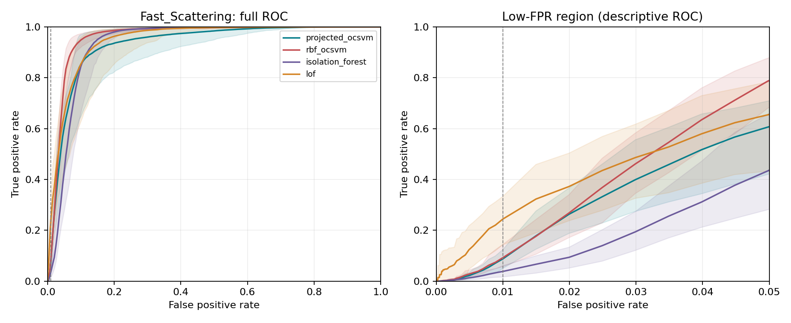
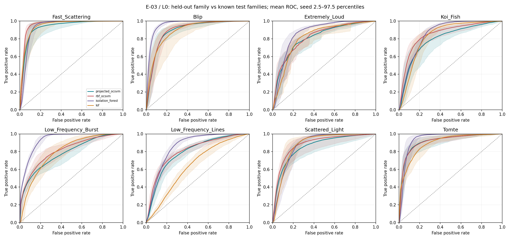

> **Validazione tecnica completata:** selezione condivisa mediante LOCO annidato su famiglie note, gamma mediana e calibrazione nu al 5%. Le nove configurazioni per modello costituiscono una deviazione esplicita dal budget generico di 60 in `docs/decisions.md §4`; nessuna accettazione formale o superiorità di H3 è dichiarata. La documentazione del metodo e la risposta alla review sono in [E03_REVIEW_RESPONSE.md](E03_REVIEW_RESPONSE.md).

# E-03 — Risultati L0: Gravity Spy D-02 (issue #29)

## Ambito della misura

Eseguiti **80 casi P2**, con 8 famiglie held-out, 10 seed e quattro modelli. Input: 318,801 righe, verificate rispetto al bundle D-04 scelto. Questa esecuzione usa sottoinsiemi stratificati: al massimo **2048 train / 2048 validation / 8192 test** per caso, comuni ai quattro modelli. I risultati NON rappresentano un fit sull'intero training P2.

Embedding esatto L0: 8 qubit, 2 layer, s=0.1778, CZ attivi. Budget uguale: 9 configurazioni per modello, 3 fold interni per famiglia surrogata. Training, tuning e scaling escludono le famiglie sconosciute; la soglia operativa usa soltanto validation di classi note. Nessuna esecuzione hardware.

Durata registrata: 60.54 minuti. Versioni: matplotlib 3.10.9, numpy 2.2.6, pandas 2.3.3, qiskit 2.6.2, qiskit-aer 0.17.2, scikit-learn 1.7.2, scipy 1.18.1, threadpoolctl 3.8.0.

## Fast_Scattering: confronto principale

Media su 10 seed e CI bootstrap 95% tra parentesi, condizionati al test fissato. TPR@1%FPR è una statistica descrittiva della ROC del test, senza interpolare punti non raggiunti. Le ultime due colonne usano invece la soglia scelta sulla validation nota, senza usare il test per sceglierla.

| Modello | AUROC [CI] | AP [CI] | TPR@1%FPR [CI] | TPR soglia validation [CI] | FPR test soglia validation [CI] |
| --- | --- | --- | --- | --- | --- |
| projected_ocsvm | 0.9312 [0.9111, 0.9486] | 0.9007 [0.8833, 0.9156] | 0.0876 [0.0715, 0.1026] | 0.1096 [0.0790, 0.1413] | 0.0116 [0.0097, 0.0139] |
| rbf_ocsvm | 0.9583 [0.9560, 0.9608] | 0.9251 [0.9210, 0.9291] | 0.0921 [0.0752, 0.1113] | 0.1165 [0.0941, 0.1410] | 0.0116 [0.0103, 0.0130] |
| isolation_forest | 0.9336 [0.9260, 0.9408] | 0.8797 [0.8686, 0.8907] | 0.0383 [0.0304, 0.0462] | 0.0469 [0.0366, 0.0564] | 0.0117 [0.0103, 0.0132] |
| lof | 0.9473 [0.9325, 0.9580] | 0.9300 [0.9152, 0.9424] | 0.2441 [0.2070, 0.2792] | 0.2232 [0.1911, 0.2493] | 0.0087 [0.0077, 0.0097] |

Test principale per seed: 8192 eventi, frazione positiva 0.5179. AP dipende da questa prevalenza.

La fascia grafica è il percentile empirico 2,5–97,5% delle curve dei seed. Non è una banda di confidenza su eventi indipendenti. La curva è interpolata solo per visualizzazione.

## Rotazione della famiglia held-out

Ogni riga confronta soltanto la famiglia indicata con le famiglie note di quel fold (`target_family`), omettendo dal calcolo l'altra famiglia sconosciuta. Fast_Scattering resta comunque fuori da ogni training/validation. I risultati con entrambe le famiglie sconosciute positive sono disponibili separatamente come `protocol_unknown` nei CSV.

| Famiglia held-out | Modello | AUROC [CI] | AP [CI] | TPR@1%FPR [CI] |
| --- | --- | --- | --- | --- |
| Fast_Scattering | projected_ocsvm | 0.9312 [0.9111, 0.9486] | 0.9007 [0.8833, 0.9156] | 0.0876 [0.0715, 0.1026] |
| Fast_Scattering | rbf_ocsvm | 0.9583 [0.9560, 0.9608] | 0.9251 [0.9210, 0.9291] | 0.0921 [0.0752, 0.1113] |
| Fast_Scattering | isolation_forest | 0.9336 [0.9260, 0.9408] | 0.8797 [0.8686, 0.8907] | 0.0383 [0.0304, 0.0462] |
| Fast_Scattering | lof | 0.9473 [0.9325, 0.9580] | 0.9300 [0.9152, 0.9424] | 0.2441 [0.2070, 0.2792] |
| Blip | projected_ocsvm | 0.8923 [0.8764, 0.9087] | 0.7232 [0.6868, 0.7615] | 0.0492 [0.0317, 0.0700] |
| Blip | rbf_ocsvm | 0.8974 [0.8827, 0.9104] | 0.7332 [0.6941, 0.7706] | 0.0793 [0.0481, 0.1127] |
| Blip | isolation_forest | 0.9618 [0.9575, 0.9657] | 0.8743 [0.8573, 0.8903] | 0.2316 [0.1660, 0.3015] |
| Blip | lof | 0.8904 [0.8610, 0.9140] | 0.7476 [0.6975, 0.7908] | 0.1447 [0.0932, 0.1988] |
| Extremely_Loud | projected_ocsvm | 0.8116 [0.7929, 0.8281] | 0.6121 [0.5748, 0.6464] | 0.0318 [0.0203, 0.0436] |
| Extremely_Loud | rbf_ocsvm | 0.8204 [0.8066, 0.8337] | 0.6294 [0.5996, 0.6570] | 0.0500 [0.0391, 0.0603] |
| Extremely_Loud | isolation_forest | 0.8642 [0.8483, 0.8785] | 0.6201 [0.5852, 0.6531] | 0.0135 [0.0118, 0.0157] |
| Extremely_Loud | lof | 0.8157 [0.7909, 0.8355] | 0.5775 [0.5452, 0.6063] | 0.0351 [0.0207, 0.0500] |
| Koi_Fish | projected_ocsvm | 0.7979 [0.7681, 0.8239] | 0.5571 [0.5119, 0.6015] | 0.0167 [0.0142, 0.0190] |
| Koi_Fish | rbf_ocsvm | 0.8538 [0.8328, 0.8713] | 0.6566 [0.6164, 0.6920] | 0.0506 [0.0347, 0.0696] |
| Koi_Fish | isolation_forest | 0.8607 [0.8544, 0.8679] | 0.6164 [0.6001, 0.6337] | 0.0448 [0.0363, 0.0537] |
| Koi_Fish | lof | 0.8309 [0.8117, 0.8498] | 0.5447 [0.5058, 0.5842] | 0.0118 [0.0060, 0.0180] |
| Low_Frequency_Burst | projected_ocsvm | 0.7839 [0.7654, 0.8004] | 0.7085 [0.6908, 0.7258] | 0.2025 [0.1675, 0.2287] |
| Low_Frequency_Burst | rbf_ocsvm | 0.8136 [0.7931, 0.8330] | 0.7414 [0.7190, 0.7625] | 0.2155 [0.1728, 0.2525] |
| Low_Frequency_Burst | isolation_forest | 0.9348 [0.9304, 0.9385] | 0.8766 [0.8694, 0.8835] | 0.3367 [0.3246, 0.3483] |
| Low_Frequency_Burst | lof | 0.7971 [0.7722, 0.8203] | 0.6387 [0.6045, 0.6711] | 0.0159 [0.0059, 0.0271] |
| Low_Frequency_Lines | projected_ocsvm | 0.7924 [0.7746, 0.8072] | 0.5536 [0.5272, 0.5788] | 0.0321 [0.0269, 0.0379] |
| Low_Frequency_Lines | rbf_ocsvm | 0.8088 [0.7947, 0.8215] | 0.6014 [0.5788, 0.6203] | 0.0457 [0.0378, 0.0553] |
| Low_Frequency_Lines | isolation_forest | 0.8566 [0.8471, 0.8654] | 0.6159 [0.6005, 0.6311] | 0.0432 [0.0383, 0.0481] |
| Low_Frequency_Lines | lof | 0.6427 [0.6257, 0.6577] | 0.3686 [0.3543, 0.3816] | 0.0167 [0.0108, 0.0225] |
| Scattered_Light | projected_ocsvm | 0.8555 [0.8303, 0.8775] | 0.9464 [0.9398, 0.9523] | 0.0906 [0.0814, 0.0989] |
| Scattered_Light | rbf_ocsvm | 0.8835 [0.8577, 0.9046] | 0.9553 [0.9480, 0.9614] | 0.1107 [0.0941, 0.1272] |
| Scattered_Light | isolation_forest | 0.8787 [0.8648, 0.8913] | 0.9426 [0.9354, 0.9491] | 0.0553 [0.0433, 0.0697] |
| Scattered_Light | lof | 0.8769 [0.8618, 0.8936] | 0.9369 [0.9313, 0.9434] | 0.0161 [0.0110, 0.0218] |
| Tomte | projected_ocsvm | 0.9172 [0.8981, 0.9333] | 0.8901 [0.8698, 0.9067] | 0.1545 [0.1182, 0.1940] |
| Tomte | rbf_ocsvm | 0.9156 [0.8992, 0.9318] | 0.8889 [0.8714, 0.9061] | 0.1441 [0.1134, 0.1760] |
| Tomte | isolation_forest | 0.9403 [0.9320, 0.9487] | 0.8782 [0.8647, 0.8924] | 0.0560 [0.0286, 0.0837] |
| Tomte | lof | 0.8951 [0.8822, 0.9087] | 0.8768 [0.8624, 0.8923] | 0.2793 [0.2038, 0.3569] |

## Differenze appaiate nel replay principale

Differenza projected meno baseline sullo stesso seed. I CI ricampionano gli stessi indici di seed per i quattro modelli. Sono descrittivi della variabilità di training/tuning su questo test; non dimostrano superiorità statistica generale o vantaggio quantistico.

| Confronto | Metrica | Differenza media [CI 95%] |
| --- | --- | --- |
| projected_ocsvm minus rbf_ocsvm | ap | -0.0243 [-0.0413, -0.0092] |
| projected_ocsvm minus isolation_forest | ap | 0.0210 [0.0062, 0.0352] |
| projected_ocsvm minus lof | ap | -0.0292 [-0.0509, -0.0069] |
| projected_ocsvm minus rbf_ocsvm | auroc | -0.0271 [-0.0466, -0.0096] |
| projected_ocsvm minus isolation_forest | auroc | -0.0025 [-0.0201, 0.0133] |
| projected_ocsvm minus lof | auroc | -0.0161 [-0.0404, 0.0085] |
| projected_ocsvm minus rbf_ocsvm | tpr_at_1pct_fpr | -0.0046 [-0.0214, 0.0096] |
| projected_ocsvm minus isolation_forest | tpr_at_1pct_fpr | 0.0493 [0.0352, 0.0627] |
| projected_ocsvm minus lof | tpr_at_1pct_fpr | -0.1566 [-0.1994, -0.1099] |

## Nota fisica e analisi degli errori

Un OC-SVM/Isolation Forest/LOF decide noto contro anomalo: non predice quale famiglia nota sia Fast_Scattering. Perciò separiamo le famiglie note erroneamente segnalate come anomale dai vicini noti degli eventi Fast_Scattering mancati.

### Famiglie note più spesso segnalate come anomalie

Falso positivo alla soglia calibrata su validation, nel fold Fast_Scattering. Le tre famiglie con tasso più alto per modello sono mostrate sotto. Le decisioni sono sommate sui seed, che riusano gli stessi eventi: questi denominatori NON sono numeri di eventi fisici indipendenti.

| Modello | Famiglia nota | Decisioni anomale / decisioni totali | Tasso |
| --- | --- | --- | --- |
| projected_ocsvm | Low_Frequency_Lines | 52 / 2920 | 0.0178 |
| projected_ocsvm | Extremely_Loud | 41 / 3050 | 0.0134 |
| projected_ocsvm | Scattered_Light | 216 / 16940 | 0.0128 |
| rbf_ocsvm | Low_Frequency_Lines | 52 / 2920 | 0.0178 |
| rbf_ocsvm | Extremely_Loud | 51 / 3050 | 0.0167 |
| rbf_ocsvm | Tomte | 68 / 6170 | 0.0110 |
| isolation_forest | Low_Frequency_Lines | 128 / 2920 | 0.0438 |
| isolation_forest | Low_Frequency_Burst | 148 / 4200 | 0.0352 |
| isolation_forest | Extremely_Loud | 27 / 3050 | 0.0089 |
| lof | Extremely_Loud | 101 / 3050 | 0.0331 |
| lof | Low_Frequency_Lines | 54 / 2920 | 0.0185 |
| lof | Tomte | 54 / 6170 | 0.0088 |

### Famiglie vicine ai Fast_Scattering non rilevati

Per ogni Fast_Scattering sotto la soglia, cerchiamo il vicino più prossimo nel training noto, nello spazio classico delle sette feature trasformate (distanza euclidea, non nello spazio quantistico). Le due famiglie più frequenti per modello sono un indizio di sovrapposizione delle feature, non una matrice di classificazione. La frequenza dei vicini dipende anche dalla numerosità e densità delle famiglie nel training sbilanciato; da sola non prova una maggiore confusione morfologica.

| Modello | Famiglia del vicino noto | Fast_Scattering mancati associati | Quota dei mancati |
| --- | --- | --- | --- |
| projected_ocsvm | Tomte | 22015 | 0.5827 |
| projected_ocsvm | Scattered_Light | 13276 | 0.3514 |
| rbf_ocsvm | Tomte | 21773 | 0.5808 |
| rbf_ocsvm | Scattered_Light | 13222 | 0.3527 |
| isolation_forest | Tomte | 22557 | 0.5578 |
| isolation_forest | Scattered_Light | 15287 | 0.3780 |
| lof | Tomte | 19059 | 0.5783 |
| lof | Scattered_Light | 11757 | 0.3567 |

In questa esecuzione, aggregando le decisioni dei seed e dei quattro modelli, le famiglie dei vicini più frequenti sono **Tomte e Scattered_Light**. È il risultato misurato della diagnostica di vicinato, non un'etichetta predetta dai detector.

Per Tomte una spiegazione plausibile è la sovrapposizione di descrittori a bassa frequenza: Glanzer et al. descrivono la maggior parte della potenza dei Tomte sotto circa 64 Hz e Fast Scattering O3 quasi sempre sotto circa 60 Hz [1]. Questo non stabilisce una causa comune: lo stesso articolo segnala che l'accoppiamento fisico dei Tomte non è identificato. Lo scarto di informazione morfologica passando dalle immagini a sette numeri è una possibile spiegazione della vicinanza, non una verifica sperimentale del meccanismo.

**Interpretazione, distinta dal dato misurato.** Fast_Scattering e Scattered_Light sono popolazioni legate allo scattering; Glanzer et al. collegano Fast Scatter al moto del suolo nelle bande antropogenica (1–6 Hz) e microsismica [1]. Una vicinanza a Scattered_Light è quindi fisicamente plausibile, ma deve essere verificata nei numeri sopra e non assunta come risultato. Vicini di altre famiglie indicano somiglianza dei descrittori scalari, non l'identificazione dello stesso accoppiamento fisico.

Le sette feature riassumono durata, frequenze, banda, ampiezza, SNR e Q; non contengono gli archi tempo-frequenza delle immagini usate dalle classificazioni Gravity Spy. La trasformazione log/RobustScaler/clipping può inoltre rendere uguali gli estremi di popolazioni diverse. L'embedding R3 è una trasformazione di queste stesse feature: non aggiunge dati sui canali ambientali o sulla morfologia delle immagini. Sono spiegazioni possibili dei fallimenti, non una misura causale eseguita qui.

La composizione per detector e run è riportata nella tabella seguente. La letteratura riporta differenze fra siti e una maggiore prevalenza di Fast Scattering a Livingston [1]. Pur senza usare ifo/run come input, le feature possono riflettere questi domini. La selezione stratificata preserva, non elimina, questo confondimento. P2 non equivale a una prova di generalizzazione temporale O3a→O3b o di trasferimento tra detector.

## Lettura del confronto

In questa configurazione il miglior AUROC medio è di **rbf_ocsvm**. Il confronto con le baseline complete è essenziale: un miglioramento sul solo OC-SVM RBF non dimostra un vantaggio sui migliori metodi classici né un vantaggio computazionale.

## Controlli e limiti

Verifica indipendente dai file delle predizioni: **80 casi**, **3200 valori metrici** ricalcolati. Controllati hash degli output, appartenenza ai partition ID originali, esclusione delle famiglie sconosciute da TUTTO il train/validation P2, etichette del catalogo, test fisso fra seed, budget uguali e CI/differenze appaiate ricalcolate.

La configurazione è resource-bounded e non include un'analisi di sensibilità ai cap o ai parametri del circuito. Gli intervalli sono condizionati al test e non includono l'incertezza della scelta del circuito, del dataset o delle etichette ML. Le rotazioni condividono dati e non sono otto dataset indipendenti. Le etichette sono quelle ML della release, non verità fisica verificata caso per caso.

Metodo, comandi di riproduzione e significato di ogni output: [E03.md](E03.md). Suite di test e provenienza dello ZIP di base: [E03_validation.json](E03_validation.json).

## Riferimenti primari

1. Glanzer et al. (2023), *Data quality up to the third observing run of advanced LIGO: Gravity Spy glitch classifications*, [DOI 10.1088/1361-6382/acb633](https://doi.org/10.1088/1361-6382/acb633).

Fonte locale controllata: `../documentazione/2208.12849v2.pdf`, sez. 4 e appendice A. Per Low_Frequency_Burst e Low_Frequency_Lines i descrittori a bassa frequenza sono un'ipotesi di sovrapposizione, da confrontare con i conteggi di vicinato; la fonte non dimostra una causa comune con Fast_Scattering.

## Supporto per detector e run nel replay principale

Gli stessi eventi sono riutilizzati fra seed. I denominatori e i tassi sono aggregati sulle decisioni dei seed e non su eventi indipendenti.

| Modello | Detector | Run | Popolazione | Anomale / decisioni | Tasso |
| --- | --- | --- | --- | --- | --- |
| isolation_forest | H1 | O1 | note | 27 / 1040 | 0.0260 |
| isolation_forest | H1 | O2 | note | 160 / 2360 | 0.0678 |
| isolation_forest | H1 | O3a | note | 133 / 5970 | 0.0223 |
| isolation_forest | H1 | O3a | Fast_Scattering | 4 / 80 | 0.0500 |
| isolation_forest | H1 | O3b | note | 43 / 9760 | 0.0044 |
| isolation_forest | H1 | O3b | Fast_Scattering | 13 / 890 | 0.0146 |
| isolation_forest | L1 | O1 | note | 16 / 980 | 0.0163 |
| isolation_forest | L1 | O2 | note | 61 / 2210 | 0.0276 |
| isolation_forest | L1 | O3a | note | 10 / 5600 | 0.0018 |
| isolation_forest | L1 | O3a | Fast_Scattering | 636 / 16410 | 0.0388 |
| isolation_forest | L1 | O3b | note | 14 / 11570 | 0.0012 |
| isolation_forest | L1 | O3b | Fast_Scattering | 1339 / 25050 | 0.0535 |
| lof | H1 | O1 | note | 18 / 1040 | 0.0173 |
| lof | H1 | O2 | note | 85 / 2360 | 0.0360 |
| lof | H1 | O3a | note | 44 / 5970 | 0.0074 |
| lof | H1 | O3a | Fast_Scattering | 11 / 80 | 0.1375 |
| lof | H1 | O3b | note | 42 / 9760 | 0.0043 |
| lof | H1 | O3b | Fast_Scattering | 216 / 890 | 0.2427 |
| lof | L1 | O1 | note | 31 / 980 | 0.0316 |
| lof | L1 | O2 | note | 12 / 2210 | 0.0054 |
| lof | L1 | O3a | note | 51 / 5600 | 0.0091 |
| lof | L1 | O3a | Fast_Scattering | 2867 / 16410 | 0.1747 |
| lof | L1 | O3b | note | 61 / 11570 | 0.0053 |
| lof | L1 | O3b | Fast_Scattering | 6377 / 25050 | 0.2546 |
| projected_ocsvm | H1 | O1 | note | 64 / 1040 | 0.0615 |
| projected_ocsvm | H1 | O2 | note | 104 / 2360 | 0.0441 |
| projected_ocsvm | H1 | O3a | note | 37 / 5970 | 0.0062 |
| projected_ocsvm | H1 | O3a | Fast_Scattering | 6 / 80 | 0.0750 |
| projected_ocsvm | H1 | O3b | note | 29 / 9760 | 0.0030 |
| projected_ocsvm | H1 | O3b | Fast_Scattering | 200 / 890 | 0.2247 |
| projected_ocsvm | L1 | O1 | note | 40 / 980 | 0.0408 |
| projected_ocsvm | L1 | O2 | note | 42 / 2210 | 0.0190 |
| projected_ocsvm | L1 | O3a | note | 68 / 5600 | 0.0121 |
| projected_ocsvm | L1 | O3a | Fast_Scattering | 1503 / 16410 | 0.0916 |
| projected_ocsvm | L1 | O3b | note | 76 / 11570 | 0.0066 |
| projected_ocsvm | L1 | O3b | Fast_Scattering | 2940 / 25050 | 0.1174 |
| rbf_ocsvm | H1 | O1 | note | 63 / 1040 | 0.0606 |
| rbf_ocsvm | H1 | O2 | note | 115 / 2360 | 0.0487 |
| rbf_ocsvm | H1 | O3a | note | 47 / 5970 | 0.0079 |
| rbf_ocsvm | H1 | O3a | Fast_Scattering | 6 / 80 | 0.0750 |
| rbf_ocsvm | H1 | O3b | note | 32 / 9760 | 0.0033 |
| rbf_ocsvm | H1 | O3b | Fast_Scattering | 158 / 890 | 0.1775 |
| rbf_ocsvm | L1 | O1 | note | 36 / 980 | 0.0367 |
| rbf_ocsvm | L1 | O2 | note | 36 / 2210 | 0.0163 |
| rbf_ocsvm | L1 | O3a | note | 52 / 5600 | 0.0093 |
| rbf_ocsvm | L1 | O3a | Fast_Scattering | 1554 / 16410 | 0.0947 |
| rbf_ocsvm | L1 | O3b | note | 76 / 11570 | 0.0066 |
| rbf_ocsvm | L1 | O3b | Fast_Scattering | 3224 / 25050 | 0.1287 |

## Incertezza sul campione di test

`e03_event_bootstrap.csv` riporta separatamente per seed, scope e modello gli intervalli 95% per AUROC/AP/TPR da bootstrap stratificato degli eventi. `e03_event_paired_differences.csv` mantiene gli stessi indici di evento fra modelli. Questi intervalli condizionano sui conteggi di classe e sul modello addestrato; non si fondono con i CI fra seed o con le rotazioni sovrapposte.

## Ipotesi di vicinato da confrontare

Conteggi di vicino noto tra i Fast_Scattering mancati. I denominatori sommano decisioni sui seed, non eventi indipendenti; zero vicini non dimostra dissimilarità fisica. I singoli ID, score, soglie e vicini sono in `missed_fast_events.csv`.

| Modello | Famiglia candidata | Vicini / mancati | Quota |
| --- | --- | --- | --- |
| projected_ocsvm | Tomte | 22015 / 37781 | 0.5827 |
| projected_ocsvm | Scattered_Light | 13276 / 37781 | 0.3514 |
| projected_ocsvm | Low_Frequency_Burst | 718 / 37781 | 0.0190 |
| projected_ocsvm | Low_Frequency_Lines | 885 / 37781 | 0.0234 |
| rbf_ocsvm | Tomte | 21773 / 37488 | 0.5808 |
| rbf_ocsvm | Scattered_Light | 13222 / 37488 | 0.3527 |
| rbf_ocsvm | Low_Frequency_Burst | 730 / 37488 | 0.0195 |
| rbf_ocsvm | Low_Frequency_Lines | 867 / 37488 | 0.0231 |
| isolation_forest | Tomte | 22557 / 40438 | 0.5578 |
| isolation_forest | Scattered_Light | 15287 / 40438 | 0.3780 |
| isolation_forest | Low_Frequency_Burst | 826 / 40438 | 0.0204 |
| isolation_forest | Low_Frequency_Lines | 907 / 40438 | 0.0224 |
| lof | Tomte | 19059 / 32959 | 0.5783 |
| lof | Scattered_Light | 11757 / 32959 | 0.3567 |
| lof | Low_Frequency_Burst | 703 / 32959 | 0.0213 |
| lof | Low_Frequency_Lines | 553 / 32959 | 0.0168 |

## Iperparametri selezionati: replay principale

Gamma è scelta dall'AUROC LOCO di classi note usate come anomalie surrogate. Nu usa separatamente un target del 5% sui soli noti interni. La soglia operativa all'1% resta calibrata sulla validation esterna indipendente. La griglia discreta di nu e la risoluzione campionaria non garantiscono un FPR interno esattamente pari al 5%; riportiamo quello misurato.

| Seed | Modello | c | nu | Gamma finale | AUROC surrogate CV | FPR calibrazione interna |
| --- | --- | --- | --- | --- | --- | --- |
| 0 | isolation_forest | — | — | — | 0.8936 | 0.0161 |
| 0 | lof | — | — | — | 0.8387 | 0.0073 |
| 0 | projected_ocsvm | 31.622776601683793 | 0.01 | 91.54570219166739 | 0.8365 | 0.5403 |
| 0 | rbf_ocsvm | 31.622776601683793 | 0.01 | 7.923911081557321 | 0.8596 | 0.3880 |
| 1 | isolation_forest | — | — | — | 0.8982 | 0.0586 |
| 1 | lof | — | — | — | 0.8467 | 0.0073 |
| 1 | projected_ocsvm | 31.622776601683793 | 0.15 | 91.05051864596257 | 0.8486 | 0.5505 |
| 1 | rbf_ocsvm | 31.622776601683793 | 0.2 | 7.782306733351218 | 0.8666 | 0.4348 |
| 2 | isolation_forest | — | — | — | 0.8904 | 0.0220 |
| 2 | lof | — | — | — | 0.8149 | 0.0673 |
| 2 | projected_ocsvm | 10.0 | 0.01 | 28.79184229411228 | 0.8273 | 0.2357 |
| 2 | rbf_ocsvm | 31.622776601683793 | 0.01 | 7.8204963235051395 | 0.8481 | 0.3982 |
| 3 | isolation_forest | — | — | — | 0.8913 | 0.0644 |
| 3 | lof | — | — | — | 0.8426 | 0.0059 |
| 3 | projected_ocsvm | 31.622776601683793 | 0.1 | 91.35726676629277 | 0.8419 | 0.5739 |
| 3 | rbf_ocsvm | 31.622776601683793 | 0.05 | 7.816998633050348 | 0.8565 | 0.4261 |
| 4 | isolation_forest | — | — | — | 0.8962 | 0.1786 |
| 4 | lof | — | — | — | 0.8220 | 0.0908 |
| 4 | projected_ocsvm | 31.622776601683793 | 0.2 | 90.93182112403481 | 0.8376 | 0.5505 |
| 4 | rbf_ocsvm | 31.622776601683793 | 0.01 | 7.822650433098426 | 0.8631 | 0.4100 |
| 5 | isolation_forest | — | — | — | 0.8840 | 0.1830 |
| 5 | lof | — | — | — | 0.8287 | 0.0190 |
| 5 | projected_ocsvm | 10.0 | 0.05 | 28.890947598335835 | 0.8535 | 0.2313 |
| 5 | rbf_ocsvm | 31.622776601683793 | 0.2 | 7.840860183232481 | 0.8661 | 0.4026 |
| 6 | isolation_forest | — | — | — | 0.9079 | 0.1157 |
| 6 | lof | — | — | — | 0.8391 | 0.0425 |
| 6 | projected_ocsvm | 10.0 | 0.01 | 28.79995645163684 | 0.8485 | 0.2357 |
| 6 | rbf_ocsvm | 31.622776601683793 | 0.1 | 7.8763681284085445 | 0.8617 | 0.4143 |
| 7 | isolation_forest | — | — | — | 0.8922 | 0.0176 |
| 7 | lof | — | — | — | 0.8321 | 0.0132 |
| 7 | projected_ocsvm | 31.622776601683793 | 0.15 | 91.08165646332047 | 0.8420 | 0.5081 |
| 7 | rbf_ocsvm | 31.622776601683793 | 0.05 | 7.798882092156225 | 0.8633 | 0.3895 |
| 8 | isolation_forest | — | — | — | 0.8956 | 0.0571 |
| 8 | lof | — | — | — | 0.8436 | 0.0483 |
| 8 | projected_ocsvm | 31.622776601683793 | 0.05 | 91.00191245116415 | 0.8429 | 0.5593 |
| 8 | rbf_ocsvm | 31.622776601683793 | 0.15 | 7.910137949013512 | 0.8604 | 0.4392 |
| 9 | isolation_forest | — | — | — | 0.8962 | 0.0132 |
| 9 | lof | — | — | — | 0.8307 | 0.1479 |
| 9 | projected_ocsvm | 31.622776601683793 | 0.2 | 91.31430876032996 | 0.8344 | 0.5798 |
| 9 | rbf_ocsvm | 31.622776601683793 | 0.1 | 7.785083605179095 | 0.8524 | 0.4378 |
## Archivi e verifica indipendente

Il risultato completo, comprese predizioni, score di validation, ID, audit e cache Bloch, è distribuito senza conversioni dei fine riga in `results/e03/loco_1125_archives/`. I nove ZIP vanno estratti nella stessa directory nuova; `archives_manifest.json` registra SHA-256 e dimensioni. Ogni membro è stato confrontato con il manifest originale. I dati grezzi e l’ambiente Python non sono inclusi.

La verifica numerica canonica è stata eseguita sugli otto worker originali, conservati prima della rimozione dello staging. Il verificatore parallelo ha poi confrontato esattamente tutte le tabelle, gli audit, gli ID e gli hash delle predizioni/cache con l’aggregato. I CI non sono stati ricalcolati con una convenzione diversa. Ricevuta: `results/e03/review_followup_20261125/worker_checks/aggregate.json`.

Il run è eseguito sul codice non ancora committato, identificato dalle impronte dei sorgenti nel manifest; i metadati Git registrano il commit precedente. La successiva pubblicazione nella PR conserva gli stessi byte dei sorgenti di generazione. Su un nuovo checkout, i sorgenti devono avere gli stessi fine riga LF per superare la verifica SHA-256 esatta.

## Come interpretare il salto di AUROC

Il confronto degli hash degli ID conferma gli stessi training, validation e test in tutti gli 80 casi storici e corretti. Non sono aumentati gli eventi anomali e non è stato reso più facile il test. È cambiato il metodo di selezione/calibrazione del modello, insieme alla correzione dello scaling interno. Le vecchie predizioni mancanti non permettono di rivalidare i vecchi score.

AUROC 0,958 per RBF descrive l’ordinamento noto/ignoto sull’intera curva, non il 95,8% degli eventi rilevati alla soglia operativa. La TPR descrittiva all’1% di FPR è circa 9,2% per RBF e 24,4% per LOF; TPR/FPR alla soglia di validation sono riportate separatamente nella tabella principale.
