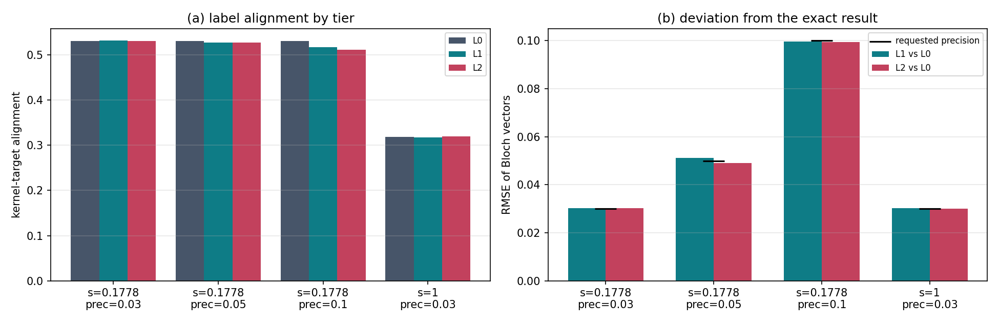
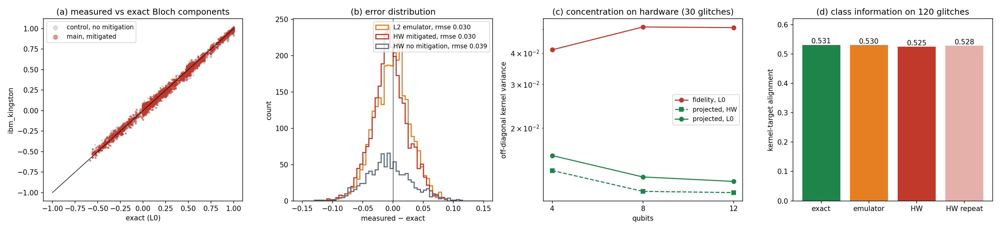

# Risultati: parte quantistica e hardware

Questo documento raccoglie tutto ciò che abbiamo misurato finora, in simulazione e sull'hardware IBM, con le figure
spiegate pannello per pannello. Ogni numero esce da uno script della repo e si può rigenerare con i comandi della
sezione 5. I concetti (vettori di Bloch, kernel proiettato, concentrazione, livelli L0–HW) sono spiegati in
`docs/GUIDA_QUANTUM_HARDWARE.md`; le scelte che ne derivano in `docs/decisions.md`.

Una misura che ricorre ovunque, la **kernel-target alignment (KTA)**: dice quanto il kernel "vede" le classi, cioè quanto
i punti della stessa classe risultano simili tra loro e diversi da quelli delle altre classi. Va da 0 (il kernel ignora le
classi) a 1 (le separa perfettamente). È una misura del kernel, non di un classificatore: dice quanto è promettente una
configurazione prima ancora di allenare una SVM.

---

## 1. Pilota hardware (H-01)

**Domanda.** Il nostro codice funziona sull'hardware vero, quanto costa davvero, e quanto rumore aggiunge il chip?

**Come.** 10 punti sintetici, 8 qubit, 2 layer, s = 1, precisione 0,03, su `ibm_kingston` con mitigazione (TREX,
twirling, dynamical decoupling). Gli stessi punti calcolati anche in modo esatto (L0), con solo rumore di misura (L1) e
con il modello di rumore di Kingston (L2). Corsa `hw-20261124T005515Z`, salvata in `store/runs/`.

**Numeri.**

| | Valore |
|---|---|
| Secondi QPU misurati / previsti dalla formula IBM / nostra stima con margine | 13 / 13,7 / 17,8 |
| Errore (RMSE) hardware contro esatto | 0,033 |
| Errore del solo campionamento (L1) | 0,030 |
| Errore dell'emulatore L2 contro esatto | 0,032 |
| Errore medio dell'hardware (sbilanciamento) | −0,0065 ± 0,0021 |


**Come leggere la figura** (`results/pilot/h01_pilot.png`):
- **(a)** ogni punto è uno dei 240 valori misurati (10 punti × 8 qubit × 3 assi X, Y, Z): in ascissa il valore esatto,
  in ordinata quello dell'hardware (rosso) o dell'emulatore (arancio). Stanno tutti sulla diagonale, da −1 a +1:
  l'hardware riproduce l'intero intervallo senza distorsioni visibili.
- **(b)** la distribuzione degli errori (misurato meno esatto) per i tre livelli. Le tre curve sono quasi sovrapposte e
  larghe circa ±0,05: l'hardware mitigato si comporta come il solo rumore statistico delle 1112 ripetizioni.
- **(c)** le barre sono l'errore dell'hardware per ciascun qubit fisico del chip; la linea tratteggiata è l'errore di
  lettura dichiarato dalla calibrazione di IBM al momento della corsa. Il qubit 72 ha l'errore di lettura peggiore (5,2%)
  ma non è il più impreciso: la correzione TREX funziona. Con 30 valori per qubit, ogni barra ha un'incertezza di circa
  ±0,004, quindi le differenze tra qubit sono in parte solo statistiche.

**Conclusioni.** La formula di costo IBM è affidabile (sbaglia di meno di un secondo). L'hardware mitigato è quasi al
limite del rumore di misura: il suo errore proprio è circa 0,014. C'è un piccolo sbilanciamento sistematico verso il
basso, compatibile con la decoerenza residua che "accorcia" i vettori di Bloch; è 5 volte più piccolo del rumore e
l'emulatore L2 lo riproduce in parte. L'emulatore è quindi un buon sostituto dell'hardware per preparare la campagna.

**Limiti.** Punti sintetici (verifica la macchina, non la classificazione), un solo job, circuito poco profondo.

---

## 2. Mappa di concentrazione sui dati veri (E-01)

**Domanda.** Con quale numero di qubit n, profondità L e bandwidth s il kernel rappresenta meglio i glitch, senza
"concentrarsi" (cioè senza diventare quasi costante e quindi inutile)?

**Come.** 196 glitch veri dal training dello split P2 (28 per ognuna delle 7 classi note), stessa normalizzazione che
userà la campagna. Simulazione esatta (L0) di tutta la griglia n ∈ {4, 6, …, 16}, L ∈ {1, 2, 4, 8}, 9 valori di s tra
0,03 e 3: 252 configurazioni per il kernel proiettato (γ = 1) e 216 per il fidelity kernel (fino a 14 qubit).


**Come leggere la figura** (`results/e01/e01_gravityspy.png`):
- **(a) concentrazione contro n**, a s = 1: in ordinata la varianza dei valori del kernel fuori dalla diagonale (scala
  logaritmica). Se scende verso zero, il kernel dà lo stesso valore a tutte le coppie e non distingue più nulla. Il
  fidelity kernel (rosso) scende di circa 6 volte da 4 a 14 qubit; il proiettato (verde) resta piatto. È la
  concentrazione prevista dalla teoria, più lieve del caso peggiore perché le feature distinte sono solo 7 e oltre 7
  qubit si ripetono.
- **(b) concentrazione contro bandwidth**, a 14 qubit e L = 2: con s troppo piccolo tutti gli stati restano vicini a
  quello iniziale e la varianza crolla per entrambi i kernel; con s grande il fidelity kernel crolla di nuovo, il
  proiettato no.
- **(c) allineamento contro n**, a s = 1: la KTA cresce fino a 8 qubit e poi si stabilizza. Servono almeno 7 qubit per
  usare tutte e 7 le feature.
- **(d) allineamento contro bandwidth**, a n = 8 e L = 2: **è la figura chiave**. La KTA ha un picco netto tra s ≈ 0,18
  e 0,56 e crolla sopra s = 1. A s = 0,1778 il proiettato vale 0,534 contro 0,357 a s = 1 (il valore usato nel pilota).

**Conclusioni.**
- La bandwidth conta più di qubit e profondità: scegliere s bene vale il 50% di allineamento in più.
- Da 8 a 12 qubit l'allineamento non cambia (0,534, 0,535, 0,530); a 14 e 16 qubit risale un po' (0,555 e 0,570).
  Più qubit però significano più qubit fisici rumorosi sull'hardware (vedi sezione 3bis). Circuiti più profondi
  (L = 4, 8) non migliorano.
- **Onestamente:** a n = 8 il fidelity kernel si allinea un po' meglio del proiettato (0,557 contro 0,534). Il
  proiettato resta la scelta per l'hardware per il costo: 360 circuiti per 120 punti invece di 7140.

**Limiti.** Un solo campione di 196 punti e un solo valore di γ per il kernel proiettato; la KTA misura la qualità del
kernel, non l'accuratezza di un classificatore (che arriverà con E-02/E-03).

---

## 3. Previsione del rumore sui punti hardware veri (Q-06)

**Domanda.** Con la configurazione scelta, il rumore dell'hardware cancellerà le differenze tra glitch che servono per
classificare? E quanta precisione serve davvero?

**Come.** I 120 punti "main" della campagna (15 per classe, Fast_Scattering compresa, mai visti in training), 8 qubit,
2 layer. Per quattro combinazioni di bandwidth e precisione: esatto (L0), solo rumore di misura (L1), modello di rumore
di Kingston (L2).



**Come leggere la figura** (`results/q06/q06_main.png`):
- **(a)** la KTA dei tre livelli per ogni configurazione. Con s = 0,1778 e precisione 0,03 le tre barre sono uguali
  (0,531 / 0,532 / 0,530): il rumore non toglie nulla. A precisione 0,1 il calo diventa visibile (0,512 in L2). Con s = 1
  tutto parte già basso (0,32).
- **(b)** l'errore dei vettori di Bloch rispetto all'esatto; il trattino nero è la precisione richiesta. L'errore
  coincide sempre con la precisione chiesta, anche col rumore del chip: le stime di costo e di qualità si possono fare
  partendo dalla precisione.

**Conclusioni.** I vettori di Bloch di glitch diversi differiscono in media di 0,23, otto volte il rumore di misura:
la configurazione scelta è robusta. La KTA sui punti mai visti (0,531) coincide con quella del campione di training di
E-01 (0,534), quindi la scelta generalizza. Corse ripetute variano di circa ±0,005: precisione 0,05 è già dentro questa
variabilità, 0,1 no. Teniamo 0,03, validata dal pilota e compatibile con il budget.

**Limiti.** L2 non include la mitigazione del server IBM, quindi è pessimistico; il confronto con e senza mitigazione
sull'hardware vero lo darà il gruppo di controllo di H-02.

---

## 3bis. 8 qubit o 16?

E-01 mostra un piccolo guadagno a 14–16 qubit. Sui 120 punti hardware veri, in simulazione esatta:

| Qubit | KTA esatta (L0) | KTA con solo rumore di misura (L1) | Profondità a 2 qubit su Kingston |
|---|---|---|---|
| 8 | 0,531 | 0,532 | 4 |
| 16 | 0,549 | 0,546 | 4 |

Il guadagno sui punti veri è +0,018 (circa il 3%), metà di quello visto sul campione di training. Il costo QPU non cambia
(sempre 3 circuiti per punto), ma 16 qubit usano il doppio dei qubit fisici, ognuno con il suo rumore. La simulazione
con il modello di rumore di Kingston a 16 qubit è più di 20 volte più lenta che a 8 e non è stata completata. Finché non
lo è, la proposta resta 8 qubit, validata sull'hardware dal pilota. Per completare la verifica:

```bash
python -c "
import sys; sys.path.insert(0, '.')
from experiments.q06_noise_prediction import load_main_subset, predict
X, y = load_main_subset(); print(predict(X, y, configs=[(0.1778, 0.03)], n_qubits=16).round(4))"
```

---

## 3ter. Campagna hardware (H-02) su ibm_kingston

**Domanda.** Le previsioni di Q-06 reggono sul chip vero? Quanto serve la mitigazione, il chip deriva, e il rumore
cambia la concentrazione o la capacità di trovare Fast_Scattering?

**Come.** Configurazione congelata (`configs/hardware_frozen.yaml`, tag `hw-freeze`): 8 qubit, 2 layer, s = 0,1778,
precisione 0,03. Sette esperimenti sui sottoinsiemi di D-05, corsa `hw-20261125T124523Z`, salvata in `store/runs/`. Una
prima sottomissione (`hw-20261125T113624Z`) si è fermata dopo `main`: la usiamo come ripetizione indipendente.
Analisi: `python experiments/h02_analysis.py` (legge solo lo store, nessun uso di QPU).

**Numeri.**

| | Valore |
|---|---|
| Secondi QPU misurati / stimati (con margine 30%) | 276 / 413 |
| Errore hardware contro esatto, main mitigato (120 glitch) | 0,030 |
| Stesso errore senza mitigazione (controllo, 40 glitch) | 0,039 |
| Errore proprio del chip senza mitigazione (√(0,039² − 0,030²)) | 0,024 |
| Allineamento KTA main: esatto / emulatore / hardware / ripetizione | 0,531 / 0,530 / 0,525 / 0,528 |
| Correlazione tra kernel esatto e kernel hardware (7140 coppie) | 0,994 |
| Differenza tra due corse hardware dello stesso main | 0,039 (atteso dal solo campionamento: 0,042) |
| Deriva tra inizio e fine campagna (5 glitch) | 0,034 (atteso: 0,042) |
| Fast_Scattering contro noti sui 120 glitch, AUROC (esatto / hardware / RBF classico) | 0,954 / 0,957 / 0,951 |



**Come leggere la figura** (`results/h02/h02_campaign.png`):
- **(a)** ogni punto è una componente di un vettore di Bloch: in ascissa il valore esatto, in ordinata quello misurato.
  Rosso: main con mitigazione; grigio: controllo senza. Tutti sulla diagonale; i grigi sono un po' più dispersi. I valori
  stanno tra −0,5 e 1 perché con s = 0,1778 gli stati restano vicini a quello iniziale (Z = 1).
- **(b)** la distribuzione degli errori (misurato meno esatto). La curva rossa (hardware mitigato) coincide con quella
  arancio (emulatore): larghezza ≈ 0,03, cioè il rumore di campionamento delle 1112 ripetizioni. La curva grigia (senza
  mitigazione) è più larga (0,039) e spostata a sinistra.
- **(c)** concentrazione: varianza dei valori del kernel fuori diagonale per 4, 8, 12 qubit sugli stessi 30 glitch.
  Verde pieno: proiettato in simulazione; verde tratteggiato: proiettato sull'hardware, circa 12% più basso (il rumore
  "accorcia" un po' i vettori) ma con lo stesso andamento piatto. Rosso: fidelity kernel in simulazione. Alla bandwidth
  scelta nessuno dei due si concentra tra 4 e 12 qubit: il crollo visto in E-01 avviene a s = 1.
- **(d)** l'allineamento con le classi sui 120 glitch: esatto, emulatore, hardware, ripetizione. Le barre sono quasi
  uguali: il rumore del chip toglie circa l'1% dell'informazione sulle classi.

**Conclusioni.**
- Q-06 aveva previsto bene: con la mitigazione l'hardware è al limite del rumore statistico (0,030) e l'allineamento
  perde 0,006. L'emulatore L2 è un buon sostituto del chip per questo circuito.
- La mitigazione serve: senza, il chip aggiunge un errore suo di circa 0,024, quasi quanto il campionamento.
- Il chip non deriva in modo misurabile durante i circa 10 minuti della campagna, e due corse diverse differiscono meno
  di quanto previsto dal solo campionamento.
- Anteprima di E-04: sui 120 glitch, un One-Class SVM allenato su 2048 glitch noti (in simulazione) separa i 15
  Fast_Scattering dai 105 noti con AUROC 0,957 usando i vettori misurati sul chip, come con quelli esatti (0,954) e
  come l'RBF classico sulle feature (0,951). Il rumore hardware non peggiora il rilevamento.

**Limiti.** 15 Fast_Scattering soltanto: l'AUROC di (d)/anteprima ha un'incertezza di qualche centesimo. Il detector
dell'anteprima usa la scelta di γ più frequente di E-03 (c = 31,6) e ν = 0,05 senza ritaratura: E-04 completo la rifà.
Un solo chip, un solo giorno.

---

## 4. Cosa ne deriva

Configurazione proposta per la campagna, in `configs/hardware_frozen.yaml` e motivata in `docs/decisions.md`:
**8 qubit, 2 layer, s = 0,1778, precisione 0,03**, circa 413 secondi QPU su 587 disponibili.

## 5. Come riprodurre

```bash
source ~/.venvs/qspy/bin/activate
python experiments/h01_pilot_plot.py              # figura del pilota, dallo store (niente QPU)
python experiments/e01_concentration.py           # E-01: dati veri, ~15 minuti; --synthetic per una prova
python experiments/q06_noise_prediction.py        # Q-06: ~1-2 minuti
```

E-01 e Q-06 richiedono i dati scaricati (`python data/download.py`) e i moduli di D-02 e D-03 in `main`.
